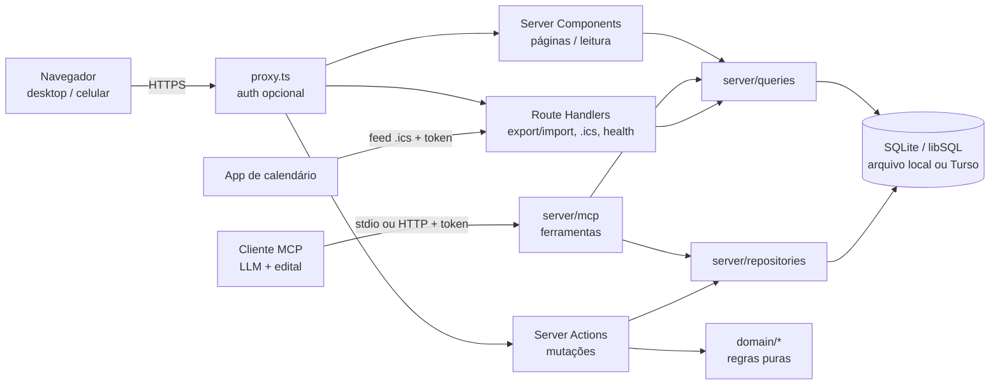
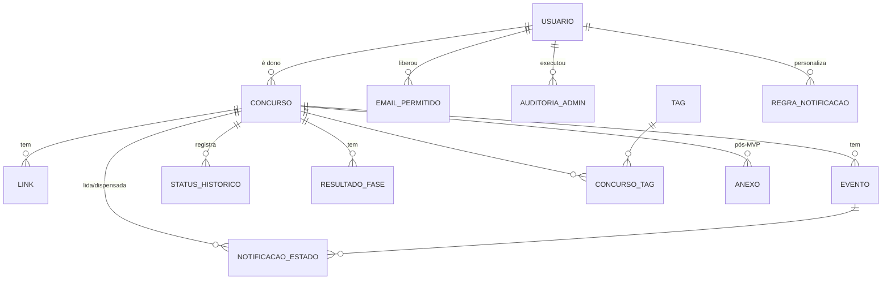

# Arquitetura — App de Controle de Concursos

> Documento de arquitetura derivado de [`REQUISITOS.md`](./REQUISITOS.md).
> Princípio-guia: **simplicidade** (uso pessoal ou de poucas pessoas, centenas de registros, roda
> local com um comando, hospedagem gratuita/barata opcional).
> Para uma introdução visual (diagramas e "onde mexo para…"), veja
> [`GUIA-ARQUITETURA.md`](./GUIA-ARQUITETURA.md).

---

## 1. Stack escolhida

| Camada | Escolha | Por quê |
|---|---|---|
| Linguagem | **TypeScript** (strict) | Tipos de ponta a ponta (banco → domínio → UI). |
| Runtime | **Node.js 24 LTS** | LTS atual; suportado por Vercel/Docker. |
| Framework (front + back) | **Next.js (App Router) + React** | Um único projeto/processo: páginas via Server Components, mutações via Server Actions. Sem API separada para manter. |
| UI | **Tailwind CSS + shadcn/ui** (Radix) | Componentes acessíveis e responsivos copiados para o repo (sem dependência de lib de UI pesada). |
| Banco | **SQLite via libSQL** (`@libsql/client`) | Arquivo único local (`data/concurso.db`), backup trivial; o mesmo driver aponta para **Turso** se hospedado em serverless. |
| ORM / migrações | **Drizzle ORM + drizzle-kit** | Leve, SQL-like, tipagem inferida do schema, migrações versionadas em SQL. |
| Validação | **Zod** | Um schema por formulário/ação, reaproveitado no cliente (react-hook-form) e no servidor. |
| Formulários | **react-hook-form** + `@hookform/resolvers/zod` | Formulários grandes (RF01) com pouca re-renderização. |
| Datas | **date-fns** + **@date-fns/tz** | Cálculo de "hoje" e prazos em `America/Sao_Paulo`. |
| Markdown | **react-markdown** + **remark-gfm** (sem HTML bruto) | Observações (RF01) renderizadas com segurança. |
| Autenticação | **`jose`** (JWT HS256 e validação do `id_token` do Google) | Sessão em cookie assinado e OIDC próprio em poucas funções testáveis, sem biblioteca de auth completa (§7.1). |
| MCP | **`@modelcontextprotocol/server`** (SDK v2) | Servidor MCP (RF10) com stdio e HTTP web-standard (`fetch`) a partir da mesma definição; só depende de Zod. |
| Testes | **Vitest** (unit/integração) + **Playwright** (e2e smoke) | Rápidos; Vitest roda o domínio puro e o banco em memória. |
| Lint/format | **Biome** | Uma ferramenta só para lint + format, rápida, configuração mínima. |
| Pacotes | **pnpm** (via Corepack) | Rápido, lockfile determinístico. |

**Alternativa descartada:** SPA (Vite + React) + API separada (Express/Fastify) + Prisma. Descartada por
dobrar a superfície (dois projetos, contrato HTTP, CORS, dois deploys) sem benefício para um app pessoal;
Prisma também traz engine/binário extra e é mais pesado que Drizzle para SQLite/Turso.

---

## 2. Visão de alto nível



- **`domain/`** é TypeScript puro (sem Next, sem banco): enums, transições de status, cálculo de prazos e
  validade. É o alvo principal dos testes (RNF07).
- **Leitura** acontece em Server Components chamando `server/queries`; **escrita** via Server Actions que
  validam com Zod → aplicam regras de `domain/` → persistem em transação → `revalidatePath`.

---

## 3. Modelo de dados

Convenções:
- IDs `integer` autoincremento. Timestamps técnicos (`created_at`, `updated_at`, `alterado_em`) em
  **UTC**, `integer` (epoch ms).
- **Datas de calendário** (eventos, homologação) como `text` `YYYY-MM-DD` e hora como `text` `HH:mm`,
  ambas interpretadas como **horário de Brasília** (wall-clock). Evita bugs de fuso em datas sem hora.
- **Dinheiro em centavos** (`integer`). Notas em `real`.
- Enums armazenados como `text` com valores em `SNAKE_CASE` (rótulos pt-BR ficam em `domain/labels.ts`).
- FKs filhas com `ON DELETE CASCADE`.



### 3.0 `usuario` (#49)

`id`, `email` (único, minúsculo; nulo só no usuário inicial não assumido), `google_sub` (único),
`nome`, `avatar_url`, `papel` (`USUARIO`/`ADMIN`), `mcp_token_hash` (SHA-256 do token do MCP),
`ultimo_acesso_em`, `bloqueado_em` (#50; nulo = ativo), `created_at`. `concurso.usuario_id` → `usuario.id` (`ON DELETE CASCADE`;
obrigatório, garantido por triggers porque a coluna foi adicionada com `ALTER TABLE`).

**Painel admin (#50, migração `0004_painel_admin`):**
- `email_permitido`: `email` (PK, minúsculo), `adicionado_por` → `usuario.id` (`SET NULL`),
  `created_at`. Allowlist do login Google gerenciada pelo painel, somada às variáveis de ambiente.
- `auditoria_admin`: `id`, `admin_id` e `alvo_usuario_id` → `usuario.id` (`SET NULL`), `admin` e
  `alvo` (cópias do e-mail/descrição no momento da ação, para o registro sobreviver a mudanças),
  `acao` (`PROMOVER_ADMIN`, `REBAIXAR_ADMIN`, `BLOQUEAR_USUARIO`, `DESBLOQUEAR_USUARIO`,
  `PERMITIR_EMAIL`, `REMOVER_EMAIL`), `created_at` (índice).

**Lembretes (#65, migração `0005_lembretes`):**
- `usuario.ics_token_hash` (SHA-256 do token do feed de calendário, único), `ics_incluir_concluidos`
  (default true) e `ics_incluir_encerrados` (default false): opções do feed e do download geral.
- `regra_notificacao`: `usuario_id` → `usuario.id` (`CASCADE`), `tipo` (`TipoEvento`), `ativo`,
  `antecedencias` (`text` "7,1,0"); PK (`usuario_id`, `tipo`). Só os tipos que diferem do padrão
  (`domain/notificacoes`) são guardados.
- `notificacao_estado`: `chave` (PK, `evento-<id>:<dias>` ou `validade-<concursoId>:<dias>`),
  `concurso_id` → `concurso.id` e `evento_id` → `evento.id` (nulo no fim da validade; ambos
  `CASCADE`), `antecedencia`, `lida_em`, `dispensada_em`. A notificação em si não é guardada.

### 3.1 `concurso` (RF01, RF03, RF05)

| Campo | Tipo | Obrig. | Observação |
|---|---|---|---|
| id | integer PK | ✔ | |
| orgao | text | ✔ | "TRF 3ª Região" |
| cargo | text | ✔ | cargo(s)/área |
| banca | text | | texto livre (autocomplete com valores já usados) |
| esfera | enum `Esfera` | | |
| uf | text(2) | | sigla validada |
| cidade | text | | |
| escolaridade | enum `Escolaridade` | | |
| remuneracao_centavos | integer | | |
| taxa_inscricao_centavos | integer | | |
| vagas_ampla | integer | | |
| vagas_cadastro_reserva | integer | | `null` = não informado; flag CR abaixo |
| possui_cadastro_reserva | boolean | | default false |
| vagas_cotas | integer | | total PcD + PPP etc. (detalhe em observações) |
| status | enum `Status` | ✔ | status atual (desnormalizado do histórico) |
| status_desde | integer (UTC) | ✔ | |
| observacoes | text (markdown) | | |
| homologacao_data | text (date) | | início da validade |
| validade_meses | integer | | 1–24 |
| validade_prorrogada | boolean | | default false |
| validade_fim_manual | text (date) | | sobrescreve o cálculo, se o edital dispuser diferente |
| validade_oculta_dashboard | boolean | | default false; oculta do dashboard o pseudo-evento de validade (#44) |
| cor | enum `CorConcurso` | | `null` = automática, derivada do ID (§7.4, #46) |
| icone | text | | um único emoji/símbolo (grafema), opcional (#46) |
| notificacoes_silenciadas | boolean | | default false; cala notificações e alarmes do concurso (#65) |
| busca_normalizada | text | ✔ | orgao+cargo+banca+tags em minúsculas sem acento (busca RF07) |
| created_at / updated_at | integer (UTC) | ✔ | |

### 3.2 `link` (RF02)
`id`, `concurso_id` FK, `tipo` enum `TipoLink`, `rotulo` text, `url` text (validada `http(s)://`),
`ordem` integer, `created_at`.

### 3.3 `evento` (RF04)
`id`, `concurso_id` FK, `tipo` enum `TipoEvento`, `titulo` text (opcional; default = rótulo do tipo),
`data` text `YYYY-MM-DD` ✔, `hora` text `HH:mm` (opcional), `local` text, `observacao` text,
`concluido` boolean (default false), `concluido_em` integer (UTC), `oculto_dashboard` boolean
(default false; oculta o evento da lista de próximos prazos do dashboard, #44), `created_at`,
`updated_at`. Índice: `(data, concluido)`.

### 3.4 `status_historico` (RF03)
`id`, `concurso_id` FK, `de` enum `Status` (null na criação), `para` enum `Status` ✔,
`alterado_em` integer (UTC) ✔, `observacao` text.

### 3.5 `resultado_fase` (RF05)
`id`, `concurso_id` FK, `fase` enum `Fase`, `descricao` text (ex.: "Discursiva — peça"), `ordem` integer,
`nota` real, `nota_maxima` real, `nota_corte` real, `classificacao_geral` integer,
`classificacao_cotas` integer, `lista_cotas` text (ex.: "PcD", "PPP"), `situacao` enum `SituacaoFase`
(default `PENDENTE`), `observacao` text.

### 3.6 `tag` e `concurso_tag` (RF01)
`tag`: `id`, `nome` text **unique** (normalizado: trim + minúsculas).
`concurso_tag`: `concurso_id` FK, `tag_id` FK, PK composta. Tags órfãs removidas ao salvar.

### 3.7 `anexo` (pós-MVP, RF02 desejável)
`id`, `concurso_id` FK, `nome_arquivo`, `mime`, `tamanho_bytes`, `chave_storage`, `created_at`.

### 3.8 Enums

| Enum | Valores |
|---|---|
| `Status` | `PREVISTO`, `EDITAL_PUBLICADO`, `INSCRITO`, `PROVA_AGENDADA`, `PROVA_REALIZADA`, `AGUARDANDO_RESULTADO`, `APROVADO`, `CLASSIFICADO`, `REPROVADO`, `NOMEADO`, `EMPOSSADO`, `DESISTIU`, `NAO_INSCRITO`, `SUSPENSO`, `CANCELADO` |
| `Esfera` | `FEDERAL`, `ESTADUAL`, `MUNICIPAL`, `DISTRITAL` |
| `Escolaridade` | `FUNDAMENTAL`, `MEDIO`, `TECNICO`, `SUPERIOR`, `POS_GRADUACAO` |
| `TipoLink` | `EDITAL_ABERTURA`, `RETIFICACAO`, `PAGINA_BANCA`, `AREA_CANDIDATO`, `GABARITO`, `RESULTADO`, `CONVOCACAO`, `OUTRO` |
| `TipoEvento` | `PUBLICACAO_EDITAL`, `INICIO_INSCRICOES`, `FIM_INSCRICOES`, `PEDIDO_ISENCAO`, `VENCIMENTO_BOLETO`, `PROVA_OBJETIVA`, `PROVA_DISCURSIVA`, `OUTRA_FASE` (TAF, títulos, psicotécnico, investigação social…), `GABARITO_PRELIMINAR`, `PRAZO_RECURSO`, `RESULTADO_FINAL`, `HOMOLOGACAO`, `CONVOCACAO`, `NOMEACAO`, `POSSE`, `VALIDADE`, `OUTRO` |
| `Fase` | `OBJETIVA`, `DISCURSIVA`, `TAF`, `TITULOS`, `PSICOTECNICO`, `INVESTIGACAO_SOCIAL`, `ORAL`, `CURSO_FORMACAO`, `OUTRA` |
| `SituacaoFase` | `PENDENTE`, `APROVADO`, `CLASSIFICADO`, `ELIMINADO`, `SUB_JUDICE` |
| `CorConcurso` | `AZUL`, `CIANO`, `VERDE_AGUA`, `VERDE`, `VIOLETA`, `MAGENTA`, `ROSA`, `CINZA` (`domain/cores.ts`) |

Semântica: **Aprovado** = dentro das vagas; **Classificado** = fora das vagas (cadastro de reserva);
**Reprovado** = eliminado/não classificado.

---

## 4. Regras de domínio (`src/domain`)

### 4.1 Transições de status

Trilha principal (índice): `PREVISTO(1) → EDITAL_PUBLICADO(2) → INSCRITO(3) → PROVA_AGENDADA(4) →
PROVA_REALIZADA(5) → AGUARDANDO_RESULTADO(6)`.

| De | Para permitido |
|---|---|
| Trilha principal (1–6) | qualquer status **posterior** da trilha (pode pular etapas) |
| `PREVISTO`, `EDITAL_PUBLICADO` | `NAO_INSCRITO` |
| `INSCRITO` … `AGUARDANDO_RESULTADO` | `DESISTIU` |
| `PROVA_REALIZADA`, `AGUARDANDO_RESULTADO` | `APROVADO`, `CLASSIFICADO`, `REPROVADO` |
| `APROVADO`, `CLASSIFICADO`, `REPROVADO` | entre si (revisão após recurso) |
| `APROVADO`, `CLASSIFICADO` | `NOMEADO`, `DESISTIU` |
| `NOMEADO` | `EMPOSSADO`, `DESISTIU` |
| qualquer não terminal | `SUSPENSO`, `CANCELADO` |
| `SUSPENSO` | o status anterior à suspensão (retomada) ou `CANCELADO` |

- **Terminais:** `EMPOSSADO`, `DESISTIU`, `NAO_INSCRITO`, `CANCELADO` (e `REPROVADO`, salvo revisão).
- **Desfazer:** sempre é possível desfazer a **última** mudança (remove o último registro do histórico
  e restaura o `de`), cobrindo erros de digitação sem liberar transições arbitrárias.
- Toda mudança grava `status_historico` e atualiza `concurso.status/status_desde` na mesma transação.
- API do domínio: `podeTransicionar(de, para)`, `transicoesPermitidas(de)`, `ehTerminal(s)`, `ehAtivo(s)`.
- **Sugestão de status** (#65, `domain/sugestao-status.ts`), só a partir de `INSCRITO` na trilha
  principal; "passou" = concluído ou `data < hoje`. Prova (objetiva/discursiva) passada →
  `PROVA_REALIZADA`; prova passada e `PRAZO_RECURSO` posterior a ela também → `AGUARDANDO_RESULTADO`;
  `INSCRITO` com prova marcada → `PROVA_AGENDADA`. Vale a mais adiantada que seja transição
  permitida. Nunca automático: a UI (detalhe e dashboard) oferece "Aplicar", que recalcula a
  sugestão no servidor, usa `alterarStatus` e grava o motivo na observação do histórico.

### 4.2 Próximos prazos (RF06)

`proximosPrazos(eventos, concursos, hoje, janelaDias = 30)`:
1. `hoje` = data atual em `America/Sao_Paulo` (injetada, para testes determinísticos).
2. Considera eventos **não concluídos** de concursos **ativos** (não terminais); para `APROVADO`,
   `CLASSIFICADO`, `NOMEADO` consideram-se também convocação/nomeação/posse/validade.
3. Inclui **pseudo-evento de validade** derivado (4.3) se não houver evento `VALIDADE` explícito.
4. Classifica em grupos: **Vencidos** (`data < hoje`, não concluído — só tipos críticos), **Hoje**,
   **Próximos N dias**.
5. **Criticidade**: tipos críticos = `FIM_INSCRICOES`, `PEDIDO_ISENCAO`, `VENCIMENTO_BOLETO`,
   `PROVA_*`, `OUTRA_FASE`, `PRAZO_RECURSO`, `POSSE`. Destaque: ≤ 3 dias = alta, ≤ 7 = média.
6. Ordenação: `data` asc, depois `hora` (sem hora = "dia inteiro", vem primeiro), depois criticidade.
7. **Ocultos** (#44): cada prazo carrega `oculto` (de `evento.oculto_dashboard` ou, para o
   pseudo-evento, `concurso.validade_oculta_dashboard`). O agrupamento não os remove;
   `semOcultos(grupos)` filtra e `contarOcultos(grupos)` alimenta o contador "N ocultos". O
   dashboard esconde os ocultos por padrão e os mostra esmaecidos com `/?ocultos=1`. A preferência
   é só de exibição: calendário e MCP continuam listando todos os prazos (o MCP informa
   `ocultoNoDashboard`), e ocultar/reexibir não altera `updated_at`. A preferência fica no próprio
   registro, que já pertence a um único usuário (via concurso, #49).

`proximaData(concurso)` = menor `data >= hoje` entre eventos não concluídos → usado na ordenação RF07.

### 4.3 Validade do concurso (RF05)

```
se validade_fim_manual → usa ela
senão se homologacao_data e validade_meses:
  fim = homologacao_data + validade_meses
  se validade_prorrogada: fim = fim + validade_meses   (prorrogação única, por igual período — CF art. 37, III)
senão → indefinida
```
- Validação: `validade_meses` entre 1 e 24.
- Exibe "vence em X dias" e alerta quando faltam ≤ 90 dias (para lembrar de acompanhar convocações).

### 4.4 Notificações (RF08, #65)

`domain/notificacoes.ts`, puro, com `hoje` injetado:
- **Regras** por `TipoEvento` (inclui `VALIDADE`, o fim da validade): `ativo` e antecedências em dias
  (0–365, até 6, sem repetição). `REGRAS_PADRAO`: fim de inscrição 7/1/0; isenção e boleto 2/0;
  provas e `OUTRA_FASE` 7/1; recurso 1/0; convocação, nomeação e posse 3/0; validade 90/30; os
  demais desligados. `mesclarRegras(personalizadas)` sobrescreve o padrão tipo a tipo.
- **Disparo sem cron** (`notificacoesDisparadas`): eventos não concluídos, de hoje em diante, de
  concursos acompanhados e não silenciados, mais o pseudo-evento de validade (§4.3). Para cada
  prazo, no máximo uma notificação: a da **antecedência vigente** = menor antecedência ≥ dias
  restantes (quem abre o app na véspera vê só "amanhã"). Identidade = (prazo, antecedência), sem a
  data: retificar a data mantém a notificação (e o estado). Do banco vêm só lida/dispensada.
- Ordenação: dia de disparo (`data − antecedência`) desc, depois data/hora do prazo.
- O contador do sino é calculado no layout do app. Toda Server Action que chama `revalidatePath`
  recebe na própria resposta a rota atual re-renderizada a partir da raiz (layout incluso), então o
  sino atualiza sem `router.refresh()` (#73).

### 4.5 Calendário iCalendar (RF08, #65)

`domain/icalendar.ts` (RFC 5545), puro, com o instante da geração injetado (`DTSTAMP`):
- Sem hora → dia inteiro (`DTSTART;VALUE=DATE`, `DTEND` no dia seguinte, `TRANSP:TRANSPARENT`).
  Com hora → convertido de Brasília para **UTC** via `instanteSP` (sem `VTIMEZONE`; respeita o
  histórico do fuso), 1 h de duração.
- `UID` estável: `evento-<id>@<host>` / `validade-<concursoId>@<host>`. Importar um backup renumera
  os eventos, o que troca os `UID`s (o calendário assinado recria os eventos uma vez).
- `SUMMARY` = [✓ se concluído] [ícone] nome do prazo — órgão; `DESCRIPTION` com tipo, concurso,
  observação e link; `URL` e `LAST-MODIFIED`.
- `VALARM` (`DISPLAY`) só em prazos críticos (§4.2) pendentes de concursos ativos e não
  silenciados, um por antecedência da regra do tipo: dia inteiro → 9h do dia do aviso; com hora →
  mesmo horário `d` dias antes, ou 2 h antes no dia.
- Texto escapado (barra invertida, `;`, `,`, quebras), linhas dobradas em 75 octetos UTF-8, CRLF;
  `REFRESH-INTERVAL`/`X-PUBLISHED-TTL` de 4 h.
- Opções: incluir concluídos e concursos encerrados (feed e download geral); o download de um
  concurso traz todos os eventos dele.

---

## 5. Rotas, telas e ações

### 5.1 Páginas (App Router)

| Rota | Tela | Fase |
|---|---|---|
| `/` | **Dashboard**: próximos prazos (vencidos/hoje/30 dias), contagem por status, atalhos; ocultar/reexibir prazos, `?ocultos=1` mostra os ocultos | MVP |
| `/concursos` | **Lista** com busca, filtros e ordenação em `searchParams` (URL compartilhável) | MVP |
| `/concursos/novo` | **Formulário** de cadastro | MVP |
| `/concursos/[id]` | **Detalhe** em abas: Visão geral · Eventos · Links · Resultados · Histórico | MVP |
| `/concursos/[id]/editar` | Formulário de edição | MVP |
| `/configuracoes` | Aparência, regras de notificação, calendário (.ics), exportar/importar dados, token do MCP, acesso | MVP |
| `/notificacoes` | **Central de notificações** (#65): marcar como lida, marcar todas, dispensar | v2.2 |
| `/login` | Login Google e/ou senha única (só se auth habilitada) | MVP |
| `/admin` | **Painel admin** (#50, só papel `ADMIN`; 403 para os demais): visão geral com totais de usuários, concursos e eventos e ações recentes | v1.4 |
| `/admin/usuarios` | Usuários (nome, e-mail, papel, cadastro, último acesso, nº de concursos); promover/rebaixar, bloquear/desbloquear | v1.4 |
| `/admin/acesso` | Allowlist do login Google: e-mails das variáveis (só leitura) e liberados no painel (adicionar/retirar) | v1.4 |
| `/admin/auditoria` | Log das ações administrativas (últimas 200) | v1.4 |
| `/concursos?visao=quadro` | Quadro por status (kanban; arrastar ou “Mover para” = transição validada) | v1.1 |
| `/calendario?mes=AAAA-MM` | Visão mensal de eventos (agenda em lista no celular); clique abre os detalhes do evento; cor/ícone por concurso com legenda (#46) | v1.1 |

Layout responsivo (alvo: 360 px sem rolagem horizontal, #48): navegação lateral no desktop, barra
inferior no celular; menu da conta (avatar) com Configurações, Sair e, só para admins, o seletor de
visão (§7.1). No celular o cabeçalho tem só marca, sino de notificações e menu da conta (na
visão admin, o selo no lugar do sino); o tema fica dentro do menu (#78). Um único sino por tela,
e sobra espaço para mais um ícone em 360 px. Em telas de toque (`pointer: coarse`), botões,
campos, abas e seletores crescem para 36–40 px, sem mudar o desktop. Tabelas largas rolam dentro do próprio contêiner (`relative
overflow-x-auto`, para o `sr-only` não escapar). Links externos com
`target="_blank" rel="noopener noreferrer"`.

PWA (#66): `app/manifest.ts` (`standalone`), ícones em `public/icons/` e `app/apple-icon.png`, e
`appleWebApp` no layout raiz (`lib/pwa.ts`). A `<meta name="theme-color">` não vem do
`viewport.themeColor` (o Next a recriaria a cada navegação): o `SCRIPT_TEMA` a cria antes da
pintura e o seletor de tema a atualiza, então a barra de status segue o tema efetivo (§7.3). O
proxy libera o manifest e os ícones sem sessão. Sem service worker por enquanto: o Chrome já instala sem ele (o Web Push, opcional em #65, ficou para depois).
Os ícones são gerados de `assets/logo.svg` por `pnpm icones` (`scripts/gerar-icones.ts`).

### 5.2 Server Actions (`src/server/actions`)

| Ação | Descrição |
|---|---|
| `criarConcurso`, `atualizarConcurso`, `excluirConcurso` | RF01 (+ tags no mesmo payload) |
| `alterarStatus(id, para, obs?)`, `desfazerUltimoStatus(id)` | RF03, usa `domain/status` |
| `salvarLink`, `excluirLink`, `reordenarLinks` | RF02 |
| `salvarEvento`, `excluirEvento`, `alternarConcluido` | RF04 |
| `alternarPrazoOculto(chave, oculto)` | RF06 — oculta/reexibe um prazo do dashboard (`evento-<id>` ou `validade-<concursoId>`, #44) |
| `salvarResultadoFase`, `excluirResultadoFase` | RF05 |
| `login`, `logout` | Auth |
| `gerarTokenMcpAcao`, `revogarTokenMcpAcao` | Token pessoal do MCP (#49) |
| `marcarNotificacaoLidaAcao(chave)`, `dispensarNotificacaoAcao(chave)`, `marcarTodasLidasAcao()` | #65 — estado das notificações (`evento-<id>:<dias>` / `validade-<id>:<dias>`) |
| `salvarRegrasNotificacaoAcao(regras)`, `restaurarRegrasPadraoAcao()`, `silenciarConcursoAcao(id, silenciado)` | #65 — regras e silenciamento por concurso |
| `gerarTokenIcsAcao`, `revogarTokenIcsAcao`, `salvarOpcoesIcsAcao(opcoes)` | #65 — feed de calendário |
| `aplicarSugestaoStatus(id, esperado)` | #65 — aplica a sugestão recalculada no servidor |
| `alternarVisaoAcao(visao)` | #50 — "usuario" ou "admin" (só admins); grava o cookie da visão e leva a `/` ou `/admin` |
| `definirPapelAcao(id, papel)`, `definirBloqueioAcao(id, bloqueado)` | #50 — admin; protege o último admin ativo e os de `ADMIN_EMAILS` |
| `adicionarEmailPermitidoAcao(email)`, `removerEmailPermitidoAcao(email)` | #50 — admin; allowlist do painel |

Todas: checagem de sessão (`exigirUsuarioAcao`, ou `exigirAdminAcao` no painel) → validação Zod →
`executar` (transação no repositório; `ErroDominio` vira mensagem, exceção inesperada vira
mensagem genérica) → `revalidatePath`. Retorno padronizado `{ ok: true, data } | { ok: false, erros }`
(`actions/resultado.ts`).

O `revalidatePath` faz a resposta da action trazer a tela atual já re-renderizada (uma viagem só ao
servidor). Por isso os componentes **não** chamam `router.refresh()` depois de `r.ok` (#73): isso
seria uma segunda requisição refazendo todas as queries do layout e da página. Exceções: a importação
(`POST /api/import`, Route Handler) e as falhas ao mover ou desfazer no quadro, que não revalidam
nada. Criar, editar e excluir concurso terminam com `redirect()` na própria action (fora de
`executar`, que engoliria o erro de controle): a resposta já traz a página de destino.

As páginas têm `loading.tsx` (#73): o esqueleto é pré-carregado e aparece na hora ao navegar. Como
o stream começa no fallback, o status HTTP fica fixado em 200 antes de a página rodar: um
`notFound()` no detalhe de um concurso inexistente (ou de outro usuário) mostra a página de não
encontrado com `<meta name="robots" content="noindex">`, mas com status 200, e o `redirect` da
visão admin no dashboard vira redirecionamento no cliente. Aceito: as páginas exigem login. O
`forbidden()` do painel admin continua 403, porque fica no layout, acima do `loading.tsx`.

### 5.3 Route Handlers (`src/app/api`)

| Rota | Uso |
|---|---|
| `GET /api/export?formato=json\|csv\|ics` | RF09 — `json` (padrão) = backup completo do usuário; `csv` = só os concursos (separador `;`, BOM UTF-8, proteção contra fórmulas); `ics` = RF08, todos os concursos ou `&concurso=<id>` |
| `POST /api/import` | RF09 — `multipart/form-data` com `arquivo` e `confirmacao=SUBSTITUIR_TUDO`; substitui todos os dados do usuário numa transação (até 20 MB; valida com Zod e `schemaVersion`; IDs renumerados) |
| `GET /api/health` | health check do deploy |
| `POST/GET/DELETE /api/mcp` | RF10 — servidor MCP (Streamable HTTP); exige `Authorization: Bearer <token pessoal>` |
| `GET /api/auth/google` e `/api/auth/google/callback` | #49 — login com Google (OIDC, código + PKCE) |
| `GET /api/calendario.ics?token=…` | RF08 (#65) — feed assinável; pública no `proxy.ts`, autenticada pelo token do feed (`cics_…`, SHA-256 em `usuario.ics_token_hash`); token inválido/revogado ou usuário bloqueado → 404; atraso progressivo como o MCP |

### 5.4 Servidor MCP (`src/server/mcp`, RF10)

Uma LLM com acesso ao edital cadastra e atualiza concursos pelo
[Model Context Protocol](https://modelcontextprotocol.io). A mesma fábrica `criarServidorMcp({ db,
usuarioId, aoAlterar })` serve dois transportes; cada instância só enxerga os dados do usuário
(#49):

- **stdio** — `pnpm --silent mcp` (`scripts/mcp.ts`), uso local, com os dados do usuário inicial;
  muda para a raiz do projeto, carrega o `.env`, aplica migrações e só escreve no stdout pelo
  protocolo.
- **HTTP** — `app/api/mcp/route.ts` com `createMcpHandler` (web-standard, stateless; uma instância
  do servidor por requisição, presa ao dono do token via `authInfo`). Pública no `proxy.ts` porque
  se autentica sozinha: token pessoal gerado em Configurações (`cmcp_…`; o banco guarda só o
  SHA-256 em `usuario.mcp_token_hash`), com o mesmo atraso progressivo do login. Após escritas,
  `revalidatePath`.

Camadas:

| Arquivo | Papel |
|---|---|
| `entradas.ts` | Schemas Zod do JSON da LLM (reais, `null` limpa, omitido mantém) → JSON Schema das ferramentas; conversores para os valores crus dos formulários |
| `operacoes.ts` | Valida com os **mesmos** schemas da UI (`lib/schemas/*`) e grava pelos repositórios; retorno `{ ok, data }` ou `{ ok, erros }`, com o caminho do item nos lotes (`eventos[2].data`) |
| `servidor.ts` | Registra ferramentas, recursos (`concurso://referencia`, `concurso://concursos/{id}`) e prompts (`cadastrar_edital`, `aplicar_retificacao`); erros viram `isError` com texto para a LLM corrigir |
| `textos.ts` | Instruções, guias dos prompts e referência dos enums com rótulos pt-BR |

Decisões (issue #39):
- **Sem ferramentas destrutivas** — nada é excluído pelo MCP; exclusões só pela UI. Todas as
  ferramentas anunciam `destructiveHint: false`.
- **Um concurso = um cargo** — o usuário escolhe o cargo no edital e a LLM preenche só os dados dele.
- **Tudo ou nada** — `cadastrar_concurso` grava concurso + eventos + links + tags numa transação
  (`criarConcursoCompleto`); `salvar_eventos`/`salvar_links` idem (`salvarEventos`/`salvarLinks`).
  Valida tudo antes de abrir a transação e devolve todos os erros de uma vez.
- **Duplicados** — `domain/duplicados.ts` compara órgão e cargo por Jaccard de palavras (sem acento
  nem palavras vazias; números diferentes distinguem órgãos). O cadastro recusa parecidos salvo
  `ignorarDuplicados`.
- **Leitura do edital no cliente** — o servidor não baixa PDFs (sem `ler_edital(url)` por ora).

---

## 6. Estrutura de pastas

```
.
├── .github/
│   ├── workflows/ci.yml            # lint, typecheck, testes, build, e2e, imagem Docker
│   ├── workflows/release.yml       # tag vX.Y.Z → GitHub Release
│   ├── dependabot.yml              # npm + actions, semanal, PRs para develop
│   └── pull_request_template.md
├── assets/                         # logo.svg (fonte dos ícones) e icon.svg
├── docs/                           # REQUISITOS.md, ARQUITETURA.md, GUIA-ARQUITETURA.md
├── drizzle/                        # migrações SQL geradas (versionadas)
├── data/                           # concurso.db local (gitignored)
├── e2e/                            # testes Playwright
├── public/icons/                   # ícones PNG do PWA (gerados por `pnpm icones`)
├── scripts/                        # migrate, seed, backup, mcp (stdio), gerar-icones, env
├── src/
│   ├── app/                        # rotas: (app)/ com navegação, admin/, login/, api/, manifest.ts
│   ├── components/
│   │   ├── ui/                     # shadcn/ui
│   │   ├── concurso/               # formulários, cards, quadro, badges, sugestão de status
│   │   ├── calendario/             # visão mensal e detalhes do evento
│   │   ├── dashboard/              # lista de prazos, ocultar/reexibir
│   │   ├── configuracoes/          # regras de notificação, calendário .ics, export/import, token MCP
│   │   ├── admin/                  # painel admin (#50)
│   │   ├── auth/                   # login (Google/senha) e sair
│   │   ├── layout/                 # casca, navegação, menu da conta
│   │   ├── notificacoes/           # sino e central de notificações (#65)
│   │   └── tema/                   # seletor de tema (claro/escuro/sistema)
│   ├── domain/                     # regras puras + testes *.test.ts ao lado
│   │   ├── enums.ts  labels.ts  erros.ts
│   │   ├── status.ts  prazos.ts  validade.ts
│   │   ├── calendario.ts  quadro.ts  cores.ts  duplicados.ts
│   │   └── notificacoes.ts  icalendar.ts  sugestao-status.ts   # lembretes (#65)
│   ├── server/
│   │   ├── db/                     # schema.ts, client.ts, migrate.ts, url.ts, backup.ts
│   │   ├── queries/                # leituras (lista, dashboard, detalhe, notificações, .ics)
│   │   ├── repositories/           # escritas transacionais
│   │   ├── actions/                # Server Actions
│   │   ├── mcp/                    # servidor MCP (ferramentas, entradas, textos)
│   │   ├── auth/                   # sessão, senha, Google, autorização, visão admin
│   │   └── inicializacao.ts        # checagem do ambiente e migrações ao iniciar
│   ├── lib/                        # format, tz, normalize, csv, tema, pwa, tags, schemas Zod
│   ├── instrumentation.ts          # chama server/inicializacao.ts ao subir o servidor
│   └── proxy.ts
├── biome.json  drizzle.config.ts  next.config.ts  vitest.config.ts  playwright.config.ts
├── .env.example  .nvmrc  CHANGELOG.md  package.json
```

---

## 7. Autenticação e locale

### 7.1 Autenticação e multiusuário (#49)
- **Multiusuário:** tabela `usuario` (e-mail, `google_sub`, nome, foto, papel `USUARIO`/`ADMIN`,
  resumo do token MCP, último acesso). `concurso.usuario_id` define o dono; links, eventos,
  histórico, resultados e anexos pertencem a ele via concurso. `tag` é um vocabulário compartilhado
  (só nomes): cada usuário vê apenas as tags dos próprios concursos. Toda query e repositório recebe
  o `usuarioId` e filtra por ele; escritas em filhas exigem antes que o concurso seja do usuário
  (`exigirConcurso`). Teste dedicado: `src/server/isolamento.test.ts`.
- **Usuário inicial (ID 1):** criado pela migração `0003_multiusuario` como admin sem e-mail e dono
  dos dados existentes. É assumido pelo primeiro login Google de um e-mail de `ADMIN_EMAILS`; o
  login por senha e o modo sem login usam sempre ele.
- **Local (padrão):** sem login configurado → auth desligada, tudo é do usuário inicial.
- **Login Google:** OIDC próprio (`server/auth/google.ts`, só `jose`): código de autorização com
  PKCE, `state` e `nonce` num cookie assinado de 10 min; `id_token` validado pelas chaves públicas
  do Google (emissor, público, expiração, `nonce`, e-mail verificado). Acesso por allowlist,
  conferida também a cada requisição (`auth/autorizacao.ts`, ver "Painel admin" abaixo).
- **Senha única (`APP_PASSWORD`):** uso local; comparada em tempo constante, com atraso progressivo
  após falhas. Em produção não pode coexistir com o Google.
- **Sessão:** cookie **JWT assinado** (`jose`, HS256 com `AUTH_SECRET` ≥ 32 bytes) com o ID do
  usuário e o método de login; `httpOnly`, `Secure` em produção, `SameSite=Lax`, 30 dias. `proxy.ts` confere só
  a assinatura (sem banco) e protege tudo exceto `/login`, `/api/health`, `/api/auth/google…`,
  `/api/mcp`, `/api/calendario.ics` e o manifest e os ícones do PWA (`lib/pwa.ts`); páginas, Server
  Actions e Route Handlers obtêm o usuário em `auth/acesso.ts`
  (`exigirUsuarioPagina/Acao/Rota`), que relê o usuário no banco.
- Em produção (`NODE_ENV=production`) sem login, o app **recusa iniciar** salvo
  `ALLOW_NO_AUTH=true` explícito — evita expor dados por esquecimento.
- Sem biblioteca de auth completa (NextAuth, Better Auth): um provedor só não justifica a
  dependência, e o fluxo OIDC cabe em poucas funções testáveis.
- **MCP (§5.4):** `/api/mcp` não usa o cookie de sessão; exige `Authorization: Bearer <token>` com o
  token pessoal do usuário (recusado se o usuário estiver bloqueado).

**Painel admin (#50):**
- **Quem entra com Google** (`auth/autorizacao.ts`): quem não está bloqueado e (a) tem o e-mail em
  `ADMIN_EMAILS` ou `ALLOWED_EMAILS`, (b) tem o e-mail liberado no painel (`email_permitido`) ou
  (c) já é admin no banco. As variáveis continuam valendo e só mudam na configuração do servidor; o
  painel soma e-mails a elas. A regra é a mesma no login e a cada requisição, então retirar um
  e-mail ou bloquear vale na hora, inclusive para sessões abertas.
- **Admins:** `ADMIN_EMAILS` são admins garantidos (promovidos a cada login, não podem ser
  rebaixados nem bloqueados pelo painel). Outros usuários podem ser promovidos no painel; o papel dá
  acesso por si só, então para tirar um admin rebaixa-se ou bloqueia-se.
- **Último admin:** sempre resta um admin ativo (papel `ADMIN`, não bloqueado). Rebaixar ou
  bloquear um admin só acontece se existir outro admin ativo, conferido no próprio `UPDATE`
  (`WHERE … AND EXISTS (outro admin ativo)`), sem janela de corrida. Ninguém bloqueia a própria
  conta; quem se rebaixa volta para a visão usuário.
- **Bloqueio:** `usuario.bloqueado_em`. Barra o login (Google e senha), a sessão existente
  (relida a cada requisição) e os tokens do MCP e do feed de calendário; os dados e o token ficam guardados e voltam a valer
  ao desbloquear. Sem login configurado (uso local), o bloqueio não se aplica.
- **Visão admin ↔ visão usuário:** seletor no menu da conta, só para admins, sem novo login. A
  escolha fica no cookie `concurso_visao` (`auth/visao.ts`) e decide o início (`/` redireciona a
  `/admin` na visão admin). A visão usuário é o app comum, sem nenhum item de admin; a visão admin
  usa outra navegação e a faixa "Modo admin". A visão **nunca** concede acesso: páginas `/admin`
  chamam `exigirAdminPagina()` (papel relido do banco; `forbidden()` → 403, com
  `experimental.authInterrupts`) e as ações, `exigirAdminAcao()` ("Acesso restrito a
  administradores").
- **Auditoria:** toda alteração do painel grava em `auditoria_admin` na mesma transação.
- **Privacidade:** o painel mostra só totais e metadados das contas; não há impersonação nem acesso
  aos concursos de outros usuários.

### 7.2 Locale (RNF04)
- `<html lang="pt-BR">`; toda a UI em pt-BR (sem i18n framework — strings diretas + `labels.ts`).
- `lib/format.ts`: `Intl.NumberFormat('pt-BR', { style: 'currency', currency: 'BRL' })`,
  `Intl.DateTimeFormat('pt-BR', { timeZone: 'America/Sao_Paulo' })` → `dd/mm/aaaa`.
- `lib/tz.ts`: `hojeSP()` e conversões via `@date-fns/tz` (`TZDate`). Nunca usar `new Date()` "solto"
  em regra de domínio — `hoje` é parâmetro.
- Entrada de moeda: máscara `R$ 1.234,56` → centavos (`parseBRL`). Entrada de data: `<input type="date">`
  (nativo, bom no celular) exibindo `dd/mm/aaaa` nos textos.
- Busca sem acento/maiúsculas via `busca_normalizada` (`normalize('NFD')` + remoção de diacríticos).
- Testes rodam com `TZ=UTC` para garantir que o código não depende do fuso da máquina.

### 7.3 Tema claro/escuro
- Preferência **Claro / Escuro / Sistema** (padrão: Sistema, via `prefers-color-scheme`), salva no
  `localStorage` (`concurso:tema`). Seletor na barra lateral (desktop), no menu da conta do
  celular (#78) e em Configurações (`components/tema/seletor-tema.tsx`, hook `useTema`); no
  modo Sistema acompanha mudanças do SO.
- Sem flash: script inline no `<head>` do layout raiz (`SCRIPT_TEMA`, `lib/tema.ts`) aplica a classe
  `dark` e o `color-scheme` no `<html>` antes da primeira pintura; o variant `dark:` do Tailwind usa
  essa classe.
- Cores sempre por tokens CSS (`globals.css`, `:root` e `.dark`), nunca fixas por tema. Atenção/aviso
  usa `--aviso` (borda/fundo) e `--aviso-foreground` (texto, contraste AA nos dois temas).

### 7.4 Cor e ícone do concurso (#46)
- Paleta fechada (`CorConcurso`, `domain/cores.ts`) com tokens `--concurso-<cor>` em `globals.css`,
  um tom escuro no `:root` e um claro no `.dark`. A cor é só marcador (ponto ao lado do nome, nunca
  fundo de texto), com contraste ≥ 3:1 (WCAG 1.4.11) contra fundo, cartão e `muted` nos dois temas
  — verificado em teste (`src/app/paleta-concurso.test.ts`). Vermelho e âmbar ficam de fora:
  são da criticidade dos prazos, que mantém borda esquerda + fundo no calendário e no painel.
- Sem escolha (`cor = null`), `corPadrao(id)` = `id × 5 mod 8`: determinística e permutação da
  paleta (IDs consecutivos têm cores diferentes). `corDoConcurso` resolve a cor exibida; as
  leituras de prazos/calendário já entregam a cor resolvida.
- Ícone: um único grafema (emoji com modificadores/ZWJ incluído), validado com `Intl.Segmenter`.
- Exibição via `components/concurso/marcador-concurso.tsx`: itens e diálogo de detalhes do
  calendário, legenda cor → concurso (concursos com itens no mês), próximos prazos do dashboard,
  lista, quadro e cabeçalho do detalhe. Formulário: rádios nativos com amostras ("Automática"
  mostra a cor derivada na edição) e campo de ícone com sugestões.
- Backup JSON (`schemaVersion` 1): `concursos[].cor`/`icone` opcionais (ausentes = `null`). MCP:
  `cor`/`icone` em cadastrar/atualizar; a ficha devolve `cor`, `corExibida` e `icone`.

---

## 8. Testes, CI e versionamento

### 8.1 Estratégia de testes
| Nível | Ferramenta | Escopo | Meta |
|---|---|---|---|
| Unitário | Vitest | `domain/*` (transições, prazos, validade, criticidade), `lib/format`, parsers BRL, schemas Zod | meta: cobertura ≥ 90% em `domain/` (medida no CI, sem limite configurado) |
| Integração | Vitest + libSQL `:memory:` + migrações | repositories/queries (transação de status, tags, filtros, export→import ida e volta); servidor MCP com cliente em memória (`InMemoryTransport`) | casos principais |
| E2E | Playwright (Chromium) | smoke: criar concurso → evento → aparece no dashboard → mudar status → exportar/importar; login, MCP, PWA e lembretes com auth ativa; painel admin com o usuário inicial (sem auth); busca, quadro, calendário, cor/ícone, ocultar prazos, tema, lembretes (sino, regras, feed .ics), sino único por tela e tema pelo menu no celular, PWA e layout em 360 px; `/api/mcp` com token → concurso visível no app. Dois servidores (com e sem auth) com bancos temporários em `e2e/.tmp` | poucos fluxos |

Datas sempre fixadas (`vi.setSystemTime` / `hoje` injetado).

### 8.2 CI (GitHub Actions)
`ci.yml` — gatilhos: `pull_request` para `develop` e `master`; `push` em `develop` e `master`.

```
jobs:
  check:  pnpm install --frozen-lockfile → biome ci → pnpm typecheck → vitest run --coverage → pnpm build
  e2e:    (needs: check) pnpm e2e (Playwright/Chromium, navegadores em cache)
  docker: (needs: check) docker build + smoke test: sem login o container sai com código 1;
          com APP_PASSWORD responde /api/health e recusa /api/export e /api/mcp sem credencial (401)
  branch-policy: em PRs para master, falha se head ≠ release/* ou hotfix/*
```
- **Proteção de branches**: `master` e `develop` exigem PR + CI verde; sem push direto.
- `release.yml`: em push de tag `v*.*.*` → cria GitHub Release com as notas da seção da versão no
  `CHANGELOG.md` (`v0.*` como pre-release). Não publica imagem Docker: ela é gerada a partir do
  `Dockerfile` por quem fizer o deploy.
- Dependabot semanal (npm + actions) com PRs para `develop`.

### 8.3 Versionamento semântico
- `0.x` durante a construção do MVP; **`v1.0.0` = MVP completo**.
- Versão bumpada em `package.json` na branch `release/X.Y.Z`; `CHANGELOG.md` no formato
  *Keep a Changelog*; PR para `master` → tag `vX.Y.Z` → PR da mesma `release/*` de volta para `develop`.
- `hotfix/*` incrementa PATCH. Mensagens de commit no estilo *Conventional Commits* (recomendado,
  não obrigatório por ferramenta).
- Mudança de schema = nova migração Drizzle; o JSON de export carrega `schemaVersion`.

---

## 9. Deploy e backup

### 9.1 Local (padrão, RNF01)
```
pnpm install
pnpm dev        # aplica migrações pendentes (predev) e sobe em http://localhost:3000
```
`pnpm build && pnpm start` para uso diário em modo produção local.

### 9.2 Hospedado (opcional, RNF08)
| Opção | Custo | Quando |
|---|---|---|
| **Vercel (Hobby) + Turso (free)** — recomendada | R$ 0 | Zero manutenção; `DATABASE_URL=libsql://…` + `DATABASE_AUTH_TOKEN` (ou `TURSO_DATABASE_URL`/`TURSO_AUTH_TOKEN`, da integração do Marketplace). Migrações rodadas no build. |
| Docker (imagem `standalone`, `Dockerfile` na raiz) em VPS/Fly.io com volume para `data/`; migrações ao iniciar (`MIGRATE_ON_START=true`) | ~US$ 2–5/mês | Se quiser anexos em disco local ou evitar serviço de banco externo. |

O mesmo código atende ambas: só muda `DATABASE_URL` (`file:./data/concurso.db` vs `libsql://…`).

### 9.3 Backup
- **Local:** `pnpm db:backup` → `VACUUM INTO 'backups/concurso-AAAAMMDD-HHmm.db'` (cópia consistente);
  manter as últimas N. Pasta `backups/` no `.gitignore` (dados pessoais **nunca** no repositório).
- **Turso:** point-in-time restore do próprio serviço + export JSON manual periódico.
- **Universal:** export JSON em `/configuracoes` (RF09), restaurável via import — também serve para
  migrar entre local ↔ hospedado.
- Não usar artefatos do GitHub Actions para backup (visíveis se o repositório for público).

---

## 10. Roadmap (ordem de implementação)

Cada item = uma branch `feature/*` a partir de `develop`; cada milestone fecha com `release/X.Y.Z`.

| Milestone | Branches (em ordem) | Entrega |
|---|---|---|
| **M0 — Fundação** → `v0.1.0` | `feature/setup-projeto` (Next, TS, Biome, Vitest, pnpm, `.env.example`) · `feature/ci-github-actions` · `feature/banco-schema-drizzle` (schema completo + migrações + client) · `feature/layout-base-pt-br` (shadcn, navegação responsiva, `format.ts`/`tz.ts`) | App vazio rodando, CI verde |
| **M1 — Cadastro** → `v0.2.0` | `feature/dominio-status` (enums, labels, transições + testes) · `feature/crud-concurso` (RF01, lista simples, detalhe) · `feature/tags` · `feature/historico-status` (RF03: troca, desfazer, timeline) · `feature/links` (RF02) | Concursos cadastráveis com status e links |
| **M2 — Prazos** → `v0.3.0` | `feature/eventos` (RF04) · `feature/dominio-prazos` (cálculo + testes) · `feature/dashboard` (RF06: prazos + contagem por status) | "O que vem a seguir" visível |
| **M3 — Busca e pós-prova** → `v0.4.0` | `feature/busca-filtros` (RF07) · `feature/resultados-fases` (RF05) · `feature/validade-concurso` | Ciclo completo até nomeação |
| **M4 — Backup e hospedagem** → **`v1.0.0` (MVP)** | `feature/export-import` (RF09) · `feature/autenticacao` · `feature/e2e-playwright` · `feature/deploy` (Vercel+Turso, Dockerfile, `db:backup`, README) | MVP pronto para uso diário |
| **M5 — Visões** → `v1.1.0` | `feature/kanban` · `feature/calendario` | RF06 desejáveis |
| **Cadastro assistido** → `v1.2.0` | `feature/mcp` (issue #39) | RF10: servidor MCP para cadastrar/atualizar a partir do edital |
| **Ajustes de uso** → `v1.3.0` | `feature/markdown-tabelas` (#43) · `feature/dashboard-ocultar-eventos` (#44) · `feature/calendario-popup` (#45) · `feature/tema-escuro` (#47) · `feature/cor-concurso` (#46) | Melhorias pedidas no uso diário |
| **Multiusuário** → `v2.0.0` | `feature/login-google-multiusuario` (#49) · `feature/painel-admin` (#50) | Login Google, dados por usuário, painel admin (RF11) |
| **Integração Vercel + Turso** → `v2.1.0` | `feature/turso-env-vercel` (#62) | Lê `TURSO_DATABASE_URL`/`TURSO_AUTH_TOKEN` da integração do Marketplace |
| **PWA e celular** → `v2.2.0` | `feature/pwa-mobile` (#66, #48) | App instalável (manifest, ícones) e responsividade em 360 px |
| **M6 — Lembretes** → `v2.2.0` | `feature/lembretes` (#65): feed/download .ics, notificações no app com regras configuráveis, sugestão de status. E-mail descartado (2026-11-01) | RF08 |
| **Desempenho** → `v2.3.0` | `feature/performance-mutacoes` (#73) | Mutações com uma viagem só ao servidor e esqueletos de carregamento |
| **M7 — Anexos** → `v2.4.0` | `feature/anexos` | RF02 desejável |

---

## 11. Riscos e decisões pendentes (seção 7 dos requisitos)

| # | Questão | Padrão proposto | Impacto na arquitetura |
|---|---|---|---|
| 1 | Local ou hospedado? | **Local-first**, com hospedagem opcional pronta (Vercel+Turso). Auth ligada por variável de ambiente (Google multiusuário ou senha única); produção sem login bloqueada por padrão. | Nenhum retrabalho: driver libSQL e proxy de auth já previstos. |
| 2 | Anexos no MVP? | **Não** — só links no MVP (edital costuma estar em URL pública). Anexos no M7 com interface `Storage` (`disco local` / Vercel Blob ou Cloudflare R2), limite 10 MB, só PDF/imagem. | Tabela `anexo` já desenhada; backup passa a incluir arquivos. |
| 3 | E-mail desde o início? | **Não — e não será feito** (decisão de 2026-11-01). O feed **.ics assinável** (M6) faz o Google/Apple Calendar notificar no celular de graça, e as notificações no app cobrem o uso na web. | Sem cron, sem segredo extra e sem serviço de e-mail; .ics funciona até local (download manual). |

**Outros riscos**
- **Fuso/datas** (prazos errados por 1 dia): datas como `YYYY-MM-DD` de Brasília, `hoje` injetado,
  testes com `TZ=UTC`.
- **SQLite em serverless** (sistema de arquivos efêmero): mitigado pelo Turso; nunca usar arquivo local na Vercel.
- **Evolução rápida do Next.js** (APIs de cache/Server Actions mudam): manter regras em `domain/` e
  acesso a dados em `server/`, deixando o Next como camada fina e substituível.
- **Perda de dados**: backups locais rotativos + export JSON; migrações sempre reversíveis por restore
  do backup feito antes de `db:migrate`.
- **Scope creep** (plano de estudos, scraping): fora do escopo; registrar como ideias, não no roadmap.
