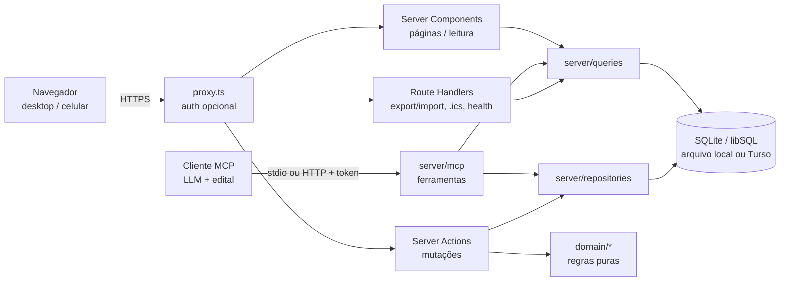
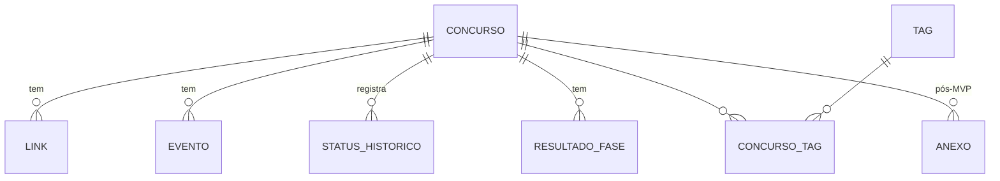

# Arquitetura — App de Controle de Concursos

> Documento de arquitetura derivado de [`REQUISITOS.md`](./REQUISITOS.md).
> Princípio-guia: **simplicidade** (um usuário, centenas de registros, roda local com um comando,
> hospedagem gratuita/barata opcional).

---

## 1. Stack escolhida

| Camada | Escolha | Por quê |
|---|---|---|
| Linguagem | **TypeScript** (strict) | Tipos de ponta a ponta (banco → domínio → UI). |
| Runtime | **Node.js 24 LTS** | LTS atual; suportado por Vercel/Docker. |
| Framework (front + back) | **Next.js (App Router) + React** | Um único projeto/processo: páginas via Server Components, mutações via Server Actions. Sem API separada para manter. |
| UI | **Tailwind CSS + shadcn/ui** (Radix) | Componentes acessíveis e responsivos copiados para o repo (sem dependência de lib de UI pesada). |
| Banco | **SQLite via libSQL** (`@libsql/client`) | Arquivo único local (`data/concurso.db`), backup trivial; o mesmo driver aponta para **Turso** se hospedado em serverless. |
| ORM / migrações | **Drizzle ORM + drizzle-kit** | Leve, SQL-like, tipagem inferida do schema, migrações versionadas em SQL. |
| Validação | **Zod** | Um schema por formulário/ação, reaproveitado no cliente (react-hook-form) e no servidor. |
| Formulários | **react-hook-form** + `@hookform/resolvers/zod` | Formulários grandes (RF01) com pouca re-renderização. |
| Datas | **date-fns** + **@date-fns/tz** | Cálculo de "hoje" e prazos em `America/Sao_Paulo`. |
| Markdown | **react-markdown** + **remark-gfm** (sem HTML bruto) | Observações (RF01) renderizadas com segurança. |
| MCP | **`@modelcontextprotocol/server`** (SDK v2) | Servidor MCP (RF10) com stdio e HTTP web-standard (`fetch`) a partir da mesma definição; só depende de Zod. |
| Testes | **Vitest** (unit/integração) + **Playwright** (e2e smoke) | Rápidos; Vitest roda o domínio puro e o banco em memória. |
| Lint/format | **Biome** | Uma ferramenta só para lint + format, rápida, configuração mínima. |
| Pacotes | **pnpm** (via Corepack) | Rápido, lockfile determinístico. |

**Alternativa descartada:** SPA (Vite + React) + API separada (Express/Fastify) + Prisma. Descartada por
dobrar a superfície (dois projetos, contrato HTTP, CORS, dois deploys) sem benefício para um app pessoal;
Prisma também traz engine/binário extra e é mais pesado que Drizzle para SQLite/Turso.

---

## 2. Visão de alto nível



- **`domain/`** é TypeScript puro (sem Next, sem banco): enums, transições de status, cálculo de prazos e
  validade. É o alvo principal dos testes (RNF07).
- **Leitura** acontece em Server Components chamando `server/queries`; **escrita** via Server Actions que
  validam com Zod → aplicam regras de `domain/` → persistem em transação → `revalidatePath`.

---

## 3. Modelo de dados

Convenções:
- IDs `integer` autoincremento. Timestamps técnicos (`created_at`, `updated_at`, `alterado_em`) em
  **UTC**, `integer` (epoch ms).
- **Datas de calendário** (eventos, homologação) como `text` `YYYY-MM-DD` e hora como `text` `HH:mm`,
  ambas interpretadas como **horário de Brasília** (wall-clock). Evita bugs de fuso em datas sem hora.
- **Dinheiro em centavos** (`integer`). Notas em `real`.
- Enums armazenados como `text` com valores em `SNAKE_CASE` (rótulos pt-BR ficam em `domain/labels.ts`).
- FKs filhas com `ON DELETE CASCADE`.



### 3.1 `concurso` (RF01, RF03, RF05)

| Campo | Tipo | Obrig. | Observação |
|---|---|---|---|
| id | integer PK | ✔ | |
| orgao | text | ✔ | "TRF 3ª Região" |
| cargo | text | ✔ | cargo(s)/área |
| banca | text | | texto livre (autocomplete com valores já usados) |
| esfera | enum `Esfera` | | |
| uf | text(2) | | sigla validada |
| cidade | text | | |
| escolaridade | enum `Escolaridade` | | |
| remuneracao_centavos | integer | | |
| taxa_inscricao_centavos | integer | | |
| vagas_ampla | integer | | |
| vagas_cadastro_reserva | integer | | `null` = não informado; flag CR abaixo |
| possui_cadastro_reserva | boolean | | default false |
| vagas_cotas | integer | | total PcD + PPP etc. (detalhe em observações) |
| status | enum `Status` | ✔ | status atual (desnormalizado do histórico) |
| status_desde | integer (UTC) | ✔ | |
| observacoes | text (markdown) | | |
| homologacao_data | text (date) | | início da validade |
| validade_meses | integer | | 1–24 |
| validade_prorrogada | boolean | | default false |
| validade_fim_manual | text (date) | | sobrescreve o cálculo, se o edital dispuser diferente |
| busca_normalizada | text | ✔ | orgao+cargo+banca+tags em minúsculas sem acento (busca RF07) |
| created_at / updated_at | integer (UTC) | ✔ | |

### 3.2 `link` (RF02)
`id`, `concurso_id` FK, `tipo` enum `TipoLink`, `rotulo` text, `url` text (validada `http(s)://`),
`ordem` integer, `created_at`.

### 3.3 `evento` (RF04)
`id`, `concurso_id` FK, `tipo` enum `TipoEvento`, `titulo` text (opcional; default = rótulo do tipo),
`data` text `YYYY-MM-DD` ✔, `hora` text `HH:mm` (opcional), `local` text, `observacao` text,
`concluido` boolean (default false), `concluido_em` integer (UTC), `created_at`, `updated_at`.
Índice: `(data, concluido)`.

### 3.4 `status_historico` (RF03)
`id`, `concurso_id` FK, `de` enum `Status` (null na criação), `para` enum `Status` ✔,
`alterado_em` integer (UTC) ✔, `observacao` text.

### 3.5 `resultado_fase` (RF05)
`id`, `concurso_id` FK, `fase` enum `Fase`, `descricao` text (ex.: "Discursiva — peça"), `ordem` integer,
`nota` real, `nota_maxima` real, `nota_corte` real, `classificacao_geral` integer,
`classificacao_cotas` integer, `lista_cotas` text (ex.: "PcD", "PPP"), `situacao` enum `SituacaoFase`
(default `PENDENTE`), `observacao` text.

### 3.6 `tag` e `concurso_tag` (RF01)
`tag`: `id`, `nome` text **unique** (normalizado: trim + minúsculas).
`concurso_tag`: `concurso_id` FK, `tag_id` FK, PK composta. Tags órfãs removidas ao salvar.

### 3.7 `anexo` (pós-MVP, RF02 desejável)
`id`, `concurso_id` FK, `nome_arquivo`, `mime`, `tamanho_bytes`, `chave_storage`, `created_at`.

### 3.8 Enums

| Enum | Valores |
|---|---|
| `Status` | `PREVISTO`, `EDITAL_PUBLICADO`, `INSCRITO`, `PROVA_AGENDADA`, `PROVA_REALIZADA`, `AGUARDANDO_RESULTADO`, `APROVADO`, `CLASSIFICADO`, `REPROVADO`, `NOMEADO`, `EMPOSSADO`, `DESISTIU`, `NAO_INSCRITO`, `SUSPENSO`, `CANCELADO` |
| `Esfera` | `FEDERAL`, `ESTADUAL`, `MUNICIPAL`, `DISTRITAL` |
| `Escolaridade` | `FUNDAMENTAL`, `MEDIO`, `TECNICO`, `SUPERIOR`, `POS_GRADUACAO` |
| `TipoLink` | `EDITAL_ABERTURA`, `RETIFICACAO`, `PAGINA_BANCA`, `AREA_CANDIDATO`, `GABARITO`, `RESULTADO`, `CONVOCACAO`, `OUTRO` |
| `TipoEvento` | `PUBLICACAO_EDITAL`, `INICIO_INSCRICOES`, `FIM_INSCRICOES`, `PEDIDO_ISENCAO`, `VENCIMENTO_BOLETO`, `PROVA_OBJETIVA`, `PROVA_DISCURSIVA`, `OUTRA_FASE` (TAF, títulos, psicotécnico, investigação social…), `GABARITO_PRELIMINAR`, `PRAZO_RECURSO`, `RESULTADO_FINAL`, `HOMOLOGACAO`, `CONVOCACAO`, `NOMEACAO`, `POSSE`, `VALIDADE`, `OUTRO` |
| `Fase` | `OBJETIVA`, `DISCURSIVA`, `TAF`, `TITULOS`, `PSICOTECNICO`, `INVESTIGACAO_SOCIAL`, `ORAL`, `CURSO_FORMACAO`, `OUTRA` |
| `SituacaoFase` | `PENDENTE`, `APROVADO`, `CLASSIFICADO`, `ELIMINADO`, `SUB_JUDICE` |

Semântica: **Aprovado** = dentro das vagas; **Classificado** = fora das vagas (cadastro de reserva);
**Reprovado** = eliminado/não classificado.

---

## 4. Regras de domínio (`src/domain`)

### 4.1 Transições de status

Trilha principal (índice): `PREVISTO(1) → EDITAL_PUBLICADO(2) → INSCRITO(3) → PROVA_AGENDADA(4) →
PROVA_REALIZADA(5) → AGUARDANDO_RESULTADO(6)`.

| De | Para permitido |
|---|---|
| Trilha principal (1–6) | qualquer status **posterior** da trilha (pode pular etapas) |
| `PREVISTO`, `EDITAL_PUBLICADO` | `NAO_INSCRITO` |
| `INSCRITO` … `AGUARDANDO_RESULTADO` | `DESISTIU` |
| `PROVA_REALIZADA`, `AGUARDANDO_RESULTADO` | `APROVADO`, `CLASSIFICADO`, `REPROVADO` |
| `APROVADO`, `CLASSIFICADO`, `REPROVADO` | entre si (revisão após recurso) |
| `APROVADO`, `CLASSIFICADO` | `NOMEADO`, `DESISTIU` |
| `NOMEADO` | `EMPOSSADO`, `DESISTIU` |
| qualquer não terminal | `SUSPENSO`, `CANCELADO` |
| `SUSPENSO` | o status anterior à suspensão (retomada) ou `CANCELADO` |

- **Terminais:** `EMPOSSADO`, `DESISTIU`, `NAO_INSCRITO`, `CANCELADO` (e `REPROVADO`, salvo revisão).
- **Desfazer:** sempre é possível desfazer a **última** mudança (remove o último registro do histórico
  e restaura o `de`), cobrindo erros de digitação sem liberar transições arbitrárias.
- Toda mudança grava `status_historico` e atualiza `concurso.status/status_desde` na mesma transação.
- API do domínio: `podeTransicionar(de, para)`, `transicoesPermitidas(de)`, `ehTerminal(s)`, `ehAtivo(s)`.
- (Pós-MVP) **Sugestão de status**: se existe evento `PROVA_OBJETIVA` concluído/passado e status é
  `PROVA_AGENDADA`, a UI sugere "Marcar como Prova realizada" (nunca automático).

### 4.2 Próximos prazos (RF06)

`proximosPrazos(eventos, concursos, hoje, janelaDias = 30)`:
1. `hoje` = data atual em `America/Sao_Paulo` (injetada, para testes determinísticos).
2. Considera eventos **não concluídos** de concursos **ativos** (não terminais); para `APROVADO`,
   `CLASSIFICADO`, `NOMEADO` consideram-se também convocação/nomeação/posse/validade.
3. Inclui **pseudo-evento de validade** derivado (4.3) se não houver evento `VALIDADE` explícito.
4. Classifica em grupos: **Vencidos** (`data < hoje`, não concluído — só tipos críticos), **Hoje**,
   **Próximos N dias**.
5. **Criticidade**: tipos críticos = `FIM_INSCRICOES`, `PEDIDO_ISENCAO`, `VENCIMENTO_BOLETO`,
   `PROVA_*`, `OUTRA_FASE`, `PRAZO_RECURSO`, `POSSE`. Destaque: ≤ 3 dias = alta, ≤ 7 = média.
6. Ordenação: `data` asc, depois `hora` (sem hora = "dia inteiro", vem primeiro), depois criticidade.

`proximaData(concurso)` = menor `data >= hoje` entre eventos não concluídos → usado na ordenação RF07.

### 4.3 Validade do concurso (RF05)

```
se validade_fim_manual → usa ela
senão se homologacao_data e validade_meses:
  fim = homologacao_data + validade_meses
  se validade_prorrogada: fim = fim + validade_meses   (prorrogação única, por igual período — CF art. 37, III)
senão → indefinida
```
- Validação: `validade_meses` entre 1 e 24.
- Exibe "vence em X dias" e alerta quando faltam ≤ 90 dias (para lembrar de acompanhar convocações).

---

## 5. Rotas, telas e ações

### 5.1 Páginas (App Router)

| Rota | Tela | Fase |
|---|---|---|
| `/` | **Dashboard**: próximos prazos (vencidos/hoje/30 dias), contagem por status, atalhos | MVP |
| `/concursos` | **Lista** com busca, filtros e ordenação em `searchParams` (URL compartilhável) | MVP |
| `/concursos/novo` | **Formulário** de cadastro | MVP |
| `/concursos/[id]` | **Detalhe** em abas: Visão geral · Eventos · Links · Resultados · Histórico | MVP |
| `/concursos/[id]/editar` | Formulário de edição | MVP |
| `/configuracoes` | Exportar/importar dados, sobre/versão | MVP |
| `/login` | Senha única (só se auth habilitada) | MVP |
| `/concursos?visao=quadro` | Quadro por status (kanban; arrastar ou “Mover para” = transição validada) | v1.1 |
| `/calendario?mes=AAAA-MM` | Visão mensal de eventos (agenda em lista no celular); clique abre os detalhes do evento | v1.1 |

Layout responsivo: navegação lateral no desktop, barra inferior no celular. Links externos com
`target="_blank" rel="noopener noreferrer"`.

### 5.2 Server Actions (`src/server/actions`)

| Ação | Descrição |
|---|---|
| `criarConcurso`, `atualizarConcurso`, `excluirConcurso` | RF01 (+ tags no mesmo payload) |
| `alterarStatus(id, para, obs?)`, `desfazerUltimoStatus(id)` | RF03, usa `domain/status` |
| `salvarLink`, `excluirLink`, `reordenarLinks` | RF02 |
| `salvarEvento`, `excluirEvento`, `alternarConcluido` | RF04 |
| `salvarResultadoFase`, `excluirResultadoFase` | RF05 |
| `login`, `logout` | Auth |

Todas: validação Zod → checagem de sessão (quando auth ativa) → transação → `revalidatePath`.
Retorno padronizado `{ ok: true, data } | { ok: false, erros }`.

### 5.3 Route Handlers (`src/app/api`)

| Rota | Uso |
|---|---|
| `GET /api/export?formato=json\|csv` | RF09 (CSV = um arquivo por entidade em `.zip`, ou só concursos) |
| `POST /api/import` | RF09 — importa JSON (substituir tudo ou mesclar; valida com Zod e versão do schema) |
| `GET /api/health` | health check do deploy |
| `POST/GET/DELETE /api/mcp` | RF10 — servidor MCP (Streamable HTTP); desligado sem `MCP_TOKEN`, exige `Authorization: Bearer` |
| `GET /api/calendario.ics?token=…` | RF08, pós-MVP (assinável no Google Calendar) |

### 5.4 Servidor MCP (`src/server/mcp`, RF10)

Uma LLM com acesso ao edital cadastra e atualiza concursos pelo
[Model Context Protocol](https://modelcontextprotocol.io). A mesma fábrica `criarServidorMcp({ db,
aoAlterar })` serve dois transportes:

- **stdio** — `pnpm --silent mcp` (`scripts/mcp.ts`), uso local; muda para a raiz do projeto, carrega
  o `.env`, aplica migrações e só escreve no stdout pelo protocolo.
- **HTTP** — `app/api/mcp/route.ts` com `createMcpHandler` (web-standard, stateless; uma instância
  do servidor por requisição). Pública no `proxy.ts` porque se autentica sozinha: `MCP_TOKEN`
  (≥ 32 caracteres) comparado em tempo constante, com o mesmo atraso progressivo do login. Sem
  `MCP_TOKEN` responde 404; token curto impede o app de iniciar. Após escritas, `revalidatePath`.

Camadas:

| Arquivo | Papel |
|---|---|
| `entradas.ts` | Schemas Zod do JSON da LLM (reais, `null` limpa, omitido mantém) → JSON Schema das ferramentas; conversores para os valores crus dos formulários |
| `operacoes.ts` | Valida com os **mesmos** schemas da UI (`lib/schemas/*`) e grava pelos repositórios; retorno `{ ok, data }` ou `{ ok, erros }`, com o caminho do item nos lotes (`eventos[2].data`) |
| `servidor.ts` | Registra ferramentas, recursos (`concurso://referencia`, `concurso://concursos/{id}`) e prompts (`cadastrar_edital`, `aplicar_retificacao`); erros viram `isError` com texto para a LLM corrigir |
| `textos.ts` | Instruções, guias dos prompts e referência dos enums com rótulos pt-BR |

Decisões (issue #39):
- **Sem ferramentas destrutivas** — nada é excluído pelo MCP; exclusões só pela UI. Todas as
  ferramentas anunciam `destructiveHint: false`.
- **Um concurso = um cargo** — o usuário escolhe o cargo no edital e a LLM preenche só os dados dele.
- **Tudo ou nada** — `cadastrar_concurso` grava concurso + eventos + links + tags numa transação
  (`criarConcursoCompleto`); `salvar_eventos`/`salvar_links` idem (`salvarEventos`/`salvarLinks`).
  Valida tudo antes de abrir a transação e devolve todos os erros de uma vez.
- **Duplicados** — `domain/duplicados.ts` compara órgão e cargo por Jaccard de palavras (sem acento
  nem palavras vazias; números diferentes distinguem órgãos). O cadastro recusa parecidos salvo
  `ignorarDuplicados`.
- **Leitura do edital no cliente** — o servidor não baixa PDFs (sem `ler_edital(url)` por ora).

---

## 6. Estrutura de pastas

```
.
├── .github/
│   ├── workflows/ci.yml            # lint, typecheck, testes, build
│   ├── workflows/release.yml       # tag vX.Y.Z → GitHub Release
│   └── pull_request_template.md
├── docs/                           # REQUISITOS.md, ARQUITETURA.md, ADRs futuros
├── drizzle/                        # migrações SQL geradas (versionadas)
├── data/                           # concurso.db local (gitignored)
├── e2e/                            # testes Playwright
├── scripts/                        # backup.ts, seed.ts, mcp.ts (stdio)
├── src/
│   ├── app/                        # rotas (páginas, layouts, api/)
│   ├── components/
│   │   ├── ui/                     # shadcn/ui
│   │   └── concurso/               # formulários, cards, tabelas, badges de status
│   ├── domain/                     # regras puras + testes *.test.ts ao lado
│   │   ├── enums.ts  labels.ts
│   │   ├── status.ts  prazos.ts  validade.ts
│   ├── server/
│   │   ├── db/                     # schema.ts, client.ts, migrate.ts
│   │   ├── queries/                # leituras (lista, dashboard, detalhe)
│   │   ├── repositories/           # escritas transacionais
│   │   ├── actions/                # Server Actions
│   │   ├── mcp/                    # servidor MCP (ferramentas, entradas, textos)
│   │   └── auth/                   # sessão, senha
│   ├── lib/                        # format.ts (BRL, datas), tz.ts, normalize.ts, schemas zod
│   └── proxy.ts
├── biome.json  drizzle.config.ts  next.config.ts  vitest.config.ts  playwright.config.ts
├── .env.example  .nvmrc  CHANGELOG.md  package.json
```

---

## 7. Autenticação e locale

### 7.1 Autenticação
- **Local (padrão):** sem `APP_PASSWORD` definido → auth desligada, app escuta só em `localhost`.
- **Hospedado:** definir `APP_PASSWORD` e `AUTH_SECRET` (≥ 32 bytes). Login com senha única comparada
  em tempo constante; sessão em cookie **JWT assinado** (`jose`), `httpOnly`, `secure`, `SameSite=Lax`,
  30 dias. `proxy.ts` (antigo `middleware.ts` no Next 16) protege tudo exceto `/login` e `/api/health`; Server Actions revalidam a
  sessão (defesa em profundidade). Atraso progressivo após falhas de login.
- Em produção (`NODE_ENV=production`) sem `APP_PASSWORD`, o app **recusa iniciar** salvo
  `ALLOW_NO_AUTH=true` explícito — evita expor dados por esquecimento.
- Sem biblioteca de auth completa (NextAuth etc.): um usuário não justifica o custo.
- **MCP (§5.4):** `/api/mcp` não usa o cookie de sessão; exige `Authorization: Bearer <MCP_TOKEN>`
  e fica desligado sem a variável.

### 7.2 Locale (RNF04)
- `<html lang="pt-BR">`; toda a UI em pt-BR (sem i18n framework — strings diretas + `labels.ts`).
- `lib/format.ts`: `Intl.NumberFormat('pt-BR', { style: 'currency', currency: 'BRL' })`,
  `Intl.DateTimeFormat('pt-BR', { timeZone: 'America/Sao_Paulo' })` → `dd/mm/aaaa`.
- `lib/tz.ts`: `hojeSP()` e conversões via `@date-fns/tz` (`TZDate`). Nunca usar `new Date()` "solto"
  em regra de domínio — `hoje` é parâmetro.
- Entrada de moeda: máscara `R$ 1.234,56` → centavos (`parseBRL`). Entrada de data: `<input type="date">`
  (nativo, bom no celular) exibindo `dd/mm/aaaa` nos textos.
- Busca sem acento/maiúsculas via `busca_normalizada` (`normalize('NFD')` + remoção de diacríticos).
- Testes rodam com `TZ=UTC` para garantir que o código não depende do fuso da máquina.

---

## 8. Testes, CI e versionamento

### 8.1 Estratégia de testes
| Nível | Ferramenta | Escopo | Meta |
|---|---|---|---|
| Unitário | Vitest | `domain/*` (transições, prazos, validade, criticidade), `lib/format`, parsers BRL, schemas Zod | cobertura ≥ 90% em `domain/` |
| Integração | Vitest + libSQL `:memory:` + migrações | repositories/queries (transação de status, tags, filtros, export→import ida e volta); servidor MCP com cliente em memória (`InMemoryTransport`) | casos principais |
| E2E | Playwright (Chromium) | smoke: criar concurso → evento → aparece no dashboard → mudar status → exportar; login quando auth ativa; `/api/mcp` com token → concurso visível no app | poucos fluxos |

Datas sempre fixadas (`vi.setSystemTime` / `hoje` injetado).

### 8.2 CI (GitHub Actions)
`ci.yml` — gatilhos: `pull_request` para `develop` e `master`; `push` em `develop` e `master`.

```
jobs:
  check:  pnpm install --frozen-lockfile → biome ci → tsc --noEmit → vitest run --coverage → next build
  e2e:    (needs: check) playwright — em PRs para master e push em develop
  branch-policy: em PRs para master, falha se head ≠ release/* ou hotfix/*
```
- **Proteção de branches**: `master` e `develop` exigem PR + CI verde; sem push direto.
- `release.yml`: em push de tag `v*.*.*` → cria GitHub Release com notas do `CHANGELOG.md`
  (e imagem Docker no GHCR, se usado o deploy em container).
- Dependabot semanal (npm + actions) com PRs para `develop`.

### 8.3 Versionamento semântico
- `0.x` durante a construção do MVP; **`v1.0.0` = MVP completo**.
- Versão bumpada em `package.json` na branch `release/X.Y.Z`; `CHANGELOG.md` no formato
  *Keep a Changelog*; merge em `master` → tag `vX.Y.Z` → merge de volta em `develop`.
- `hotfix/*` incrementa PATCH. Mensagens de commit no estilo *Conventional Commits* (recomendado,
  não obrigatório por ferramenta).
- Mudança de schema = nova migração Drizzle; o JSON de export carrega `schemaVersion`.

---

## 9. Deploy e backup

### 9.1 Local (padrão, RNF01)
```
pnpm install
pnpm dev        # aplica migrações pendentes (predev) e sobe em http://localhost:3000
```
`pnpm build && pnpm start` para uso diário em modo produção local.

### 9.2 Hospedado (opcional, RNF08)
| Opção | Custo | Quando |
|---|---|---|
| **Vercel (Hobby) + Turso (free)** — recomendada | R$ 0 | Zero manutenção; `DATABASE_URL=libsql://…` + `DATABASE_AUTH_TOKEN`. Migrações rodadas no build. |
| Docker (imagem `standalone`, `Dockerfile` na raiz) em VPS/Fly.io com volume para `data/`; migrações ao iniciar (`MIGRATE_ON_START=true`) | ~US$ 2–5/mês | Se quiser anexos em disco local ou evitar serviço de banco externo. |

O mesmo código atende ambas: só muda `DATABASE_URL` (`file:./data/concurso.db` vs `libsql://…`).

### 9.3 Backup
- **Local:** `pnpm db:backup` → `VACUUM INTO 'backups/concurso-AAAAMMDD-HHmm.db'` (cópia consistente);
  manter as últimas N. Pasta `backups/` no `.gitignore` (dados pessoais **nunca** no repositório).
- **Turso:** point-in-time restore do próprio serviço + export JSON manual periódico.
- **Universal:** export JSON em `/configuracoes` (RF09), restaurável via import — também serve para
  migrar entre local ↔ hospedado.
- Não usar artefatos do GitHub Actions para backup (visíveis se o repositório for público).

---

## 10. Roadmap (ordem de implementação)

Cada item = uma branch `feature/*` a partir de `develop`; cada milestone fecha com `release/X.Y.Z`.

| Milestone | Branches (em ordem) | Entrega |
|---|---|---|
| **M0 — Fundação** → `v0.1.0` | `feature/setup-projeto` (Next, TS, Biome, Vitest, pnpm, `.env.example`) · `feature/ci-github-actions` · `feature/banco-schema-drizzle` (schema completo + migrações + client) · `feature/layout-base-pt-br` (shadcn, navegação responsiva, `format.ts`/`tz.ts`) | App vazio rodando, CI verde |
| **M1 — Cadastro** → `v0.2.0` | `feature/dominio-status` (enums, labels, transições + testes) · `feature/crud-concurso` (RF01, lista simples, detalhe) · `feature/tags` · `feature/historico-status` (RF03: troca, desfazer, timeline) · `feature/links` (RF02) | Concursos cadastráveis com status e links |
| **M2 — Prazos** → `v0.3.0` | `feature/eventos` (RF04) · `feature/dominio-prazos` (cálculo + testes) · `feature/dashboard` (RF06: prazos + contagem por status) | "O que vem a seguir" visível |
| **M3 — Busca e pós-prova** → `v0.4.0` | `feature/busca-filtros` (RF07) · `feature/resultados-fases` (RF05) · `feature/validade-concurso` | Ciclo completo até nomeação |
| **M4 — Backup e hospedagem** → **`v1.0.0` (MVP)** | `feature/export-import` (RF09) · `feature/autenticacao` · `feature/e2e-playwright` · `feature/deploy` (Vercel+Turso, Dockerfile, `db:backup`, README) | MVP pronto para uso diário |
| **M5 — Visões** → `v1.1.0` | `feature/kanban` · `feature/calendario` | RF06 desejáveis |
| **Cadastro assistido** → `v1.2.0` | `feature/mcp` (issue #39) | RF10: servidor MCP para cadastrar/atualizar a partir do edital |
| **M6 — Lembretes** → `v1.3.0` | `feature/exportar-ics` (RF08) · `feature/sugestao-status` · `feature/notificacao-email` (opcional) | RF08 |
| **M7 — Anexos** → `v1.4.0` | `feature/anexos` | RF02 desejável |

---

## 11. Riscos e decisões pendentes (seção 7 dos requisitos)

| # | Questão | Padrão proposto | Impacto na arquitetura |
|---|---|---|---|
| 1 | Local ou hospedado? | **Local-first**, com hospedagem opcional pronta (Vercel+Turso). Auth ligada por variável de ambiente; produção sem senha bloqueada por padrão. | Nenhum retrabalho: driver libSQL e proxy de auth já previstos. |
| 2 | Anexos no MVP? | **Não** — só links no MVP (edital costuma estar em URL pública). Anexos no M7 com interface `Storage` (`disco local` / Vercel Blob ou Cloudflare R2), limite 10 MB, só PDF/imagem. | Tabela `anexo` já desenhada; backup passa a incluir arquivos. |
| 3 | E-mail desde o início? | **Não.** Primeiro o feed **.ics assinável** (M6): o Google/Apple Calendar notifica no celular de graça. E-mail depois, se necessário: Resend + cron (Vercel Cron ou GitHub Actions `schedule`) com resumo diário. | E-mail exige app hospedado e segredo extra; .ics funciona até local (download manual). |

**Outros riscos**
- **Fuso/datas** (prazos errados por 1 dia): datas como `YYYY-MM-DD` de Brasília, `hoje` injetado,
  testes com `TZ=UTC`.
- **SQLite em serverless** (sistema de arquivos efêmero): mitigado pelo Turso; nunca usar arquivo local na Vercel.
- **Evolução rápida do Next.js** (APIs de cache/Server Actions mudam): manter regras em `domain/` e
  acesso a dados em `server/`, deixando o Next como camada fina e substituível.
- **Perda de dados**: backups locais rotativos + export JSON; migrações sempre reversíveis por restore
  do backup feito antes de `db:migrate`.
- **Scope creep** (plano de estudos, scraping): fora do escopo; registrar como ideias, não no roadmap.
