# Guia visual da arquitetura

> Um passeio didático pelo app **concurso**: como as peças se encaixam e por quê.
> Para a especificação completa (campos, enums, roadmap), veja [`ARQUITETURA.md`](./ARQUITETURA.md);
> para o "o quê", veja [`REQUISITOS.md`](./REQUISITOS.md).
>
> Os diagramas usam [Mermaid](https://mermaid.js.org) e aparecem renderizados no GitHub e no VS Code
> (com a extensão *Markdown Preview Mermaid Support*).

---

## Sumário

1. [A ideia em uma frase](#1-a-ideia-em-uma-frase)
2. [O mapa geral](#2-o-mapa-geral)
3. [As camadas, de fora para dentro](#3-as-camadas-de-fora-para-dentro)
4. [A regra de dependência](#4-a-regra-de-dependência)
5. [Como uma página é lida](#5-como-uma-página-é-lida)
6. [Como uma alteração é gravada](#6-como-uma-alteração-é-gravada)
7. [O coração do domínio: status, prazos e lembretes](#7-o-coração-do-domínio-status-prazos-e-lembretes)
8. [O modelo de dados](#8-o-modelo-de-dados)
9. [Autenticação e multiusuário: quem passa pela porta](#9-autenticação-e-multiusuário-quem-passa-pela-porta)
10. [Servidor MCP: uma LLM como segunda "interface"](#10-servidor-mcp-uma-llm-como-segunda-interface)
11. [Inicialização do servidor](#11-inicialização-do-servidor)
12. [Onde o app roda](#12-onde-o-app-roda)
13. [Testes e entrega](#13-testes-e-entrega)
14. [Mapa de pastas e "onde mexo para…"](#14-mapa-de-pastas-e-onde-mexo-para)
15. [Glossário](#15-glossário)

---

## 1. A ideia em uma frase

> **Um único projeto Next.js** em que o servidor lê e grava num **SQLite**, as **regras de negócio
> ficam em TypeScript puro** e tudo o mais (páginas, formulários, MCP, export) é só uma "casca" fina
> em volta dessas regras.

Três princípios explicam quase todas as decisões:

| Princípio | Consequência prática |
|---|---|
| **Poucos usuários, centenas de registros** | SQLite em arquivo; sem filas, cache distribuído ou microsserviços. Cada usuário só vê os próprios concursos. |
| **Roda com um comando** | `pnpm dev` aplica migrações e cria o banco sozinho. |
| **O framework muda rápido; as regras não** | Regras em `src/domain/` (sem Next, sem banco), testadas isoladamente. |

---

## 2. O mapa geral

Quem conversa com quem, do navegador (ou da LLM) até o banco:

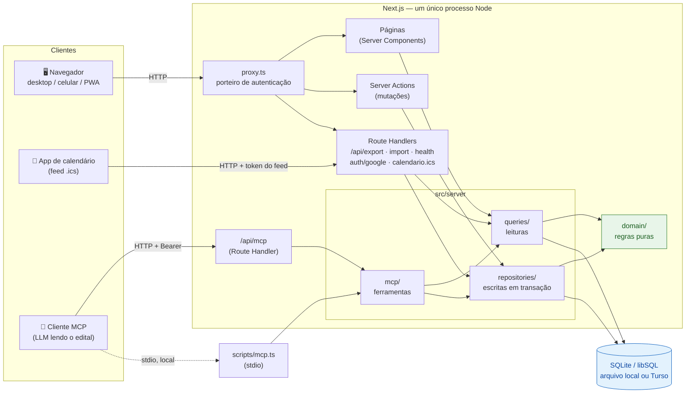

**Leitura do diagrama:**

- Há **três portas de entrada**: o navegador (pelas páginas), uma LLM (pelo protocolo MCP) e o
  app de calendário que assina o feed `.ics`. Todas chegam nos **mesmos** `queries/` e
  `repositories/` — não existe "lógica duplicada para a IA".
- Toda leitura e escrita recebe o `usuarioId` de quem pediu (sessão, token do MCP ou token do
  feed) e filtra por ele: um usuário nunca enxerga os concursos de outro.
- **Ler** e **escrever** são caminhos separados: `queries/` só lê; `repositories/` só escreve
  (sempre em transação).
- O bloco verde (`domain/`) não conhece Next.js nem banco. É chamado por quem precisa de uma regra.

---

## 3. As camadas, de fora para dentro

Pense no app como uma cebola. Cada camada só conhece as que estão **dentro** dela.

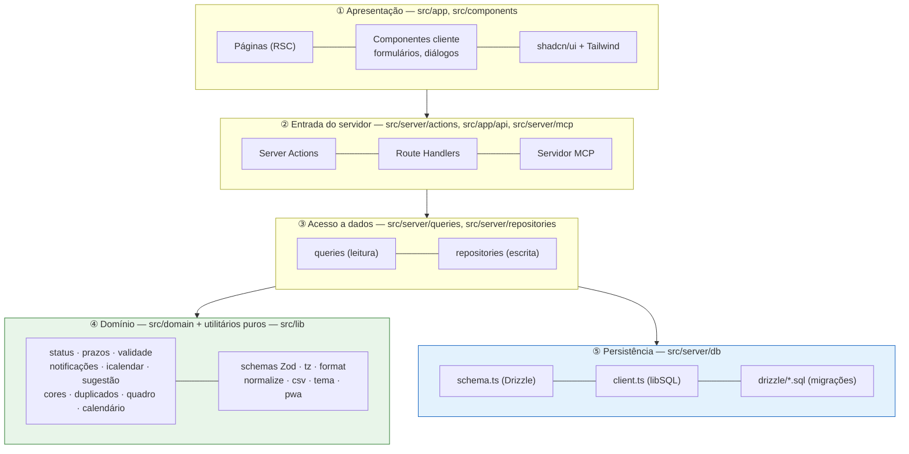

| Camada | Pergunta que responde | Exemplo real |
|---|---|---|
| ① Apresentação | *Como isso aparece na tela?* | `components/concurso/alterar-status.tsx` |
| ② Entrada | *Quem pediu? Os dados vieram certos? Pode?* | `server/actions/status.ts` |
| ③ Dados | *Como leio/gravo isso no banco?* | `server/repositories/status.ts` |
| ④ Domínio | *Isso é permitido pelas regras do negócio?* | `domain/status.ts` → `exigirTransicao()` |
| ⑤ Persistência | *Como é a tabela?* | `server/db/schema.ts` |

---

## 4. A regra de dependência

A seta sempre aponta **para dentro**. Nada no domínio importa de fora.

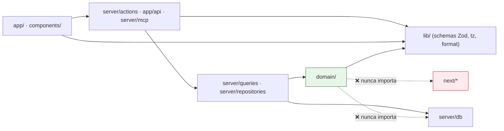

**Por que isso importa?**

- `domain/` é testado com Vitest em milissegundos, sem subir servidor nem banco.
- Se uma API do Next mudar (como `middleware.ts` → `proxy.ts` no Next 16), as regras não mudam.
- O `hoje` é sempre **parâmetro** das funções do domínio (nunca `new Date()` solto). Assim os testes
  são determinísticos e o fuso de Brasília é tratado num lugar só (`lib/tz.ts`).

---

## 5. Como uma página é lida

Exemplo: abrir o **Dashboard** (`/`). Tudo acontece no servidor; o navegador recebe HTML pronto.

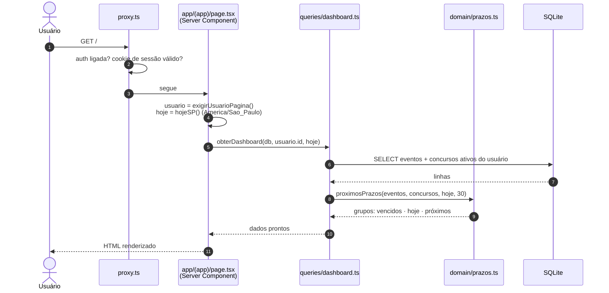

Pontos-chave:

- **Não há API REST para a tela.** O componente de página é `async` e chama a query diretamente.
- A query busca o mínimo no SQL e delega a **regra** (o que é vencido, o que é crítico) ao domínio.
- Em paralelo, a página pede o contador do sino (`queries/notificacoes.ts`) e as sugestões de
  status (`queries/sugestoes.ts`) — ambos calculados na hora, sem cron (§7.4).
- Componentes interativos (`"use client"`) são só as "ilhas" que precisam de estado: formulários,
  diálogos, seletor de tema, quadro arrastável.

---

## 6. Como uma alteração é gravada

Exemplo: mudar o status de um concurso para **Inscrito**. Este é o padrão de **todas** as mutações.

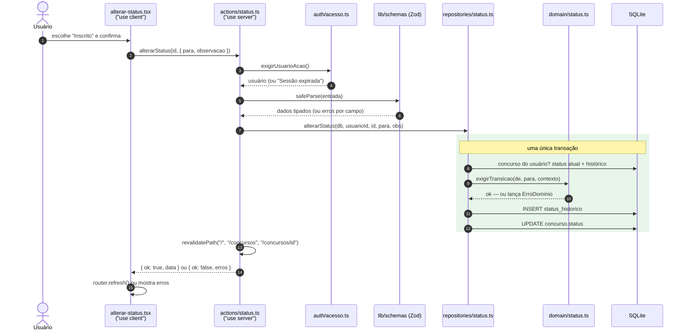

A "receita" de uma Server Action, em 5 passos:

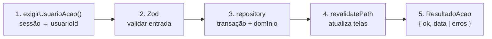

E os erros viram mensagens amigáveis num lugar só (`actions/resultado.ts → executar()`):

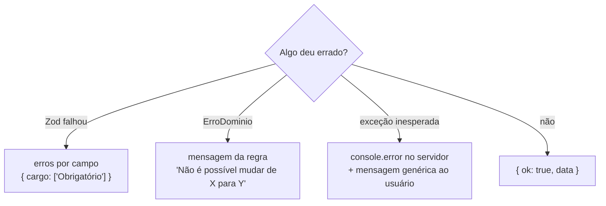

> 💡 O **mesmo schema Zod** valida o formulário no navegador (react-hook-form) e de novo no servidor.
> E o MCP também reaproveita esses schemas — uma regra de validação, três usos.

---

## 7. O coração do domínio: status, prazos e lembretes

### 7.1 A máquina de estados do status

Cada concurso percorre uma trilha. `domain/status.ts` decide quais saltos são válidos; a UI só
oferece as opções permitidas e o repositório confere de novo.

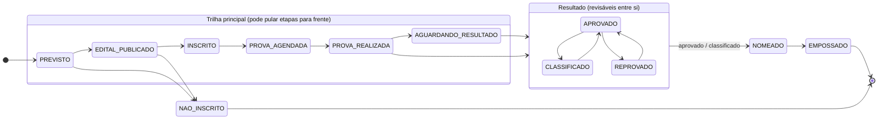

Regras que não cabem bem no desenho:

| Regra | Detalhe |
|---|---|
| **Desistir** | De `INSCRITO` em diante, e de `APROVADO`/`CLASSIFICADO`/`NOMEADO` → `DESISTIU`. |
| **Suspender / cancelar** | Qualquer status não terminal → `SUSPENSO` ou `CANCELADO`. |
| **Retomar** | `SUSPENSO` só volta para o status de **antes** da suspensão (lido do histórico). |
| **Terminais** | `EMPOSSADO`, `DESISTIU`, `NAO_INSCRITO`, `CANCELADO` e `REPROVADO` (salvo revisão). |
| **Desfazer** | Sempre dá para desfazer a **última** mudança (corrige clique errado sem abrir brecha). |

### 7.2 De eventos a "próximos prazos"

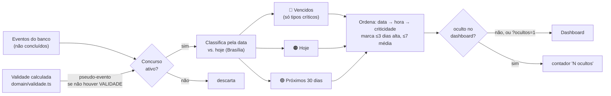

### 7.3 Validade do concurso

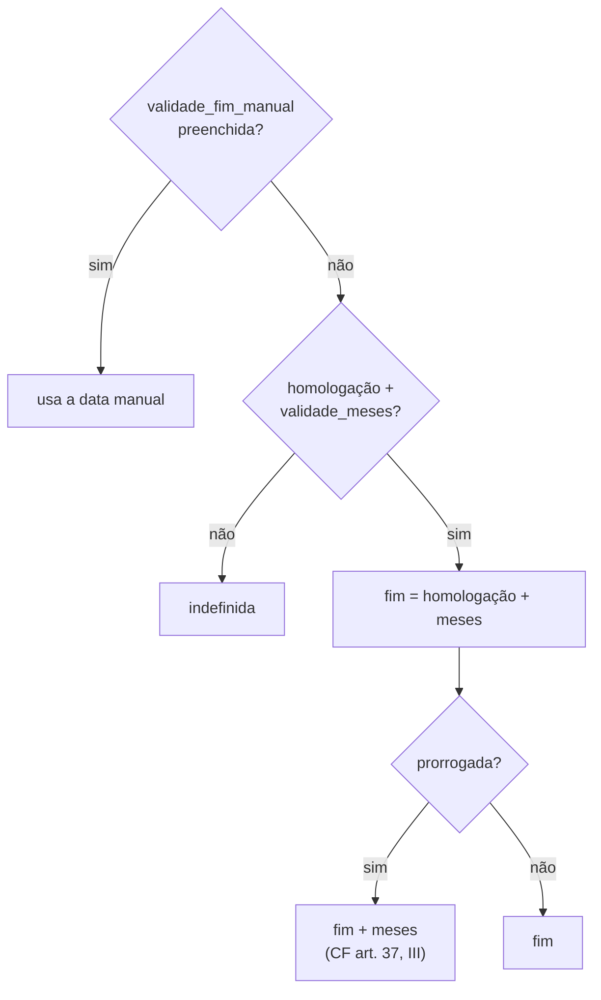

### 7.4 Lembretes: notificações, calendário e sugestão de status

Os lembretes (#65) **não usam cron nem e-mail**: tudo é calculado na hora, a partir dos eventos
pendentes, das regras do usuário e de "hoje".

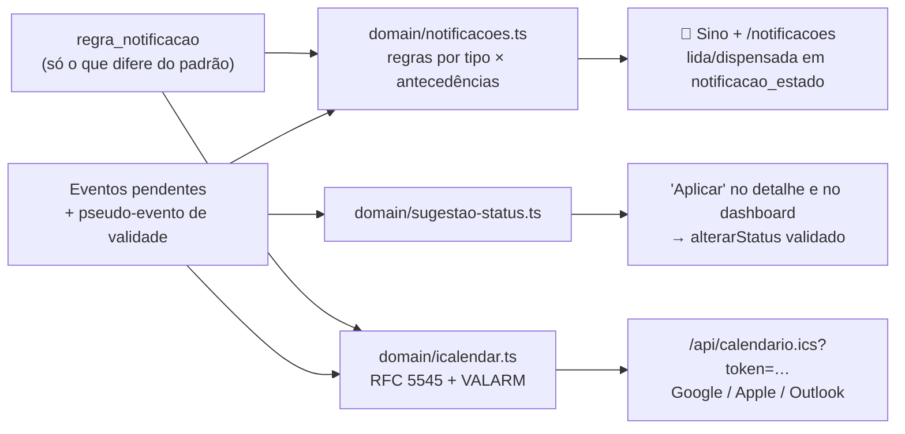

| Peça | Regra principal |
|---|---|
| **Notificação** | Identidade = (prazo, antecedência), sem a data: retificar a data não duplica o aviso. Por prazo, só vale a antecedência vigente (quem abre o app na véspera vê só "amanhã"). |
| **Silenciar** | Por concurso: cala avisos e alarmes daquele concurso. Eventos concluídos e concursos encerrados não notificam. |
| **Feed .ics** | Token pessoal (`cics_…`, só o SHA-256 no banco), `UID` estável por evento, alarmes só nos prazos críticos pendentes. |
| **Sugestão de status** | Só sugere (prova passada → "Prova realizada", etc.); "Aplicar" recalcula no servidor e grava o motivo no histórico. |

---

## 8. O modelo de dados

O **usuário** é dono dos concursos, e o **concurso** é o centro: tudo mais pendura nele (e é
apagado junto, via `ON DELETE CASCADE`).

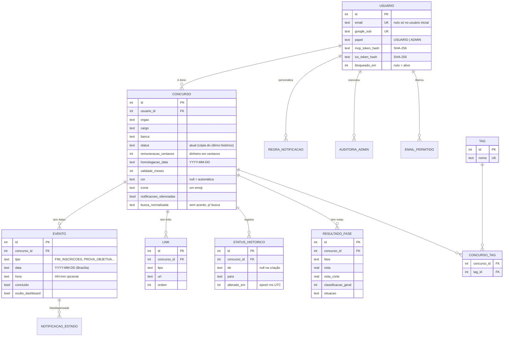

Tabelas de apoio (fora do diagrama para não poluir): `regra_notificacao` e `notificacao_estado`
(lembretes, #65), `email_permitido` e `auditoria_admin` (painel admin, #50). A `tag` é um vocabulário
compartilhado só de nomes; cada usuário vê apenas as tags dos próprios concursos. Detalhes campo a
campo em [`ARQUITETURA.md` §3](./ARQUITETURA.md#3-modelo-de-dados).

Convenções que evitam bugs clássicos:

| Tipo de dado | Como é guardado | Por quê |
|---|---|---|
| Data de calendário (prova, inscrição) | `text` `YYYY-MM-DD`, horário de Brasília | Uma prova "dia 10" nunca vira "dia 9" por causa de fuso. |
| Instante técnico (`created_at`, `alterado_em`) | `integer` epoch ms, UTC | Ordenação e comparação simples. |
| Dinheiro | `integer` em **centavos** | Sem erro de ponto flutuante (`0,1 + 0,2`). |
| Enums | `text` em `SNAKE_CASE` | Legível no banco; rótulos pt-BR em `domain/labels.ts`. |
| Status atual | Coluna em `concurso` **e** histórico | Lista rápida sem `JOIN`; histórico para timeline e "desfazer". |

As migrações vivem em `drizzle/*.sql`, geradas a partir de `src/server/db/schema.ts`:

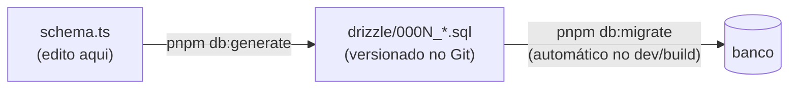

---

## 9. Autenticação e multiusuário: quem passa pela porta

A autenticação é **opcional** e ligada por variável de ambiente. Há três modos:

| Modo | Variáveis | Quem entra |
|---|---|---|
| **Sem login** (uso local) | nenhuma | todos os dados são do **usuário inicial** (ID 1) |
| **Senha única** (uso local) | `APP_PASSWORD` + `AUTH_SECRET` | sempre o usuário inicial |
| **Google** (multiusuário) | `GOOGLE_CLIENT_ID/SECRET` + `ADMIN_EMAILS` + `AUTH_SECRET` | e-mails da allowlist; o primeiro admin a entrar assume o usuário inicial |

Há duas checagens (defesa em profundidade): o `proxy.ts` na entrada, que só confere a assinatura do
cookie (sem banco), e `auth/acesso.ts` em cada página, action e handler, que relê o usuário no banco
(bloqueado? ainda na allowlist?).

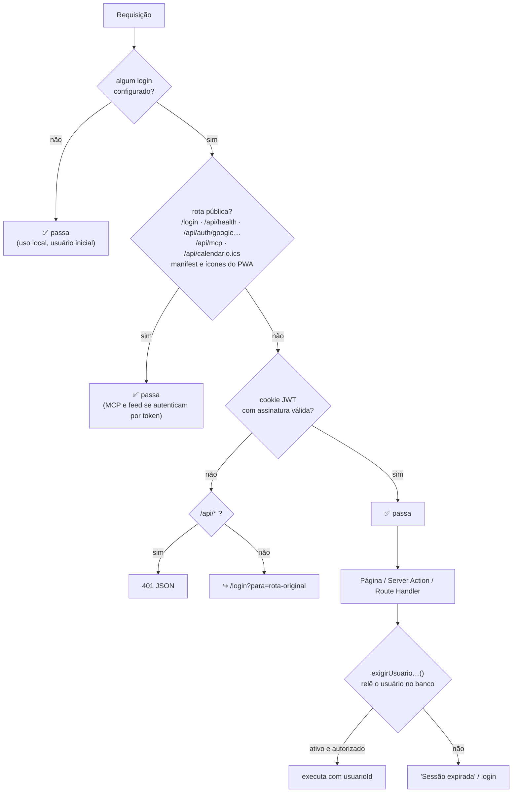

**Painel admin (#50).** Usuários com papel `ADMIN` alternam entre "Visão admin" e "Visão usuário"
no menu da conta (cookie `concurso_visao`). A visão **nunca** concede acesso: `/admin` chama
`exigirAdminPagina()` e as ações, `exigirAdminAcao()`, que conferem o papel no banco. Toda ação do
painel grava em `auditoria_admin`, e sempre resta ao menos um admin ativo.

Proteções extras, de relance:

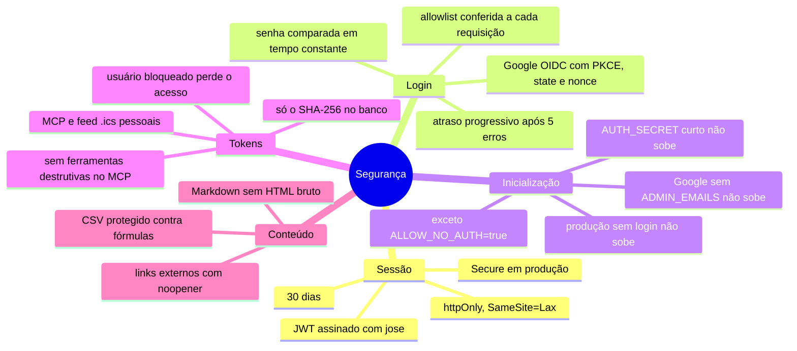

---

## 10. Servidor MCP: uma LLM como segunda "interface"

O [Model Context Protocol](https://modelcontextprotocol.io) permite que uma LLM, lendo o PDF do
edital, cadastre o concurso chamando "ferramentas". A **mesma fábrica** (`criarServidorMcp`) serve
dois transportes, e cada instância só enxerga os dados de um usuário — no stdio, o usuário inicial;
no HTTP, o dono do token pessoal gerado em **Configurações → Token do MCP** (`cmcp_…`):

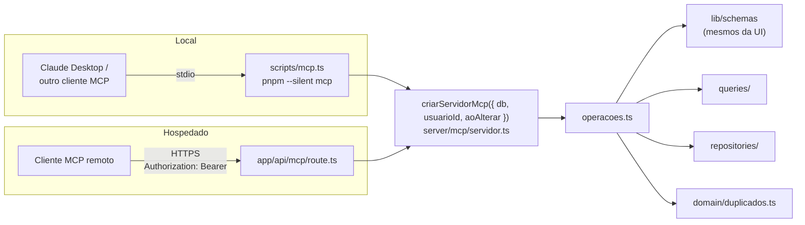

O que a LLM enxerga:

| Tipo | Itens |
|---|---|
| 🔧 **Ferramentas** | `listar_concursos`, `obter_concurso`, `proximos_prazos`, `verificar_duplicado`, `cadastrar_concurso`, `atualizar_concurso`, `alterar_status`, `salvar_eventos`, `salvar_links`, `registrar_resultado` |
| 📄 **Recursos** | `concurso://referencia` (enums e rótulos), `concurso://concursos/{id}` (ficha) |
| 💬 **Prompts** | `cadastrar_edital`, `aplicar_retificacao` |

Um cadastro típico:

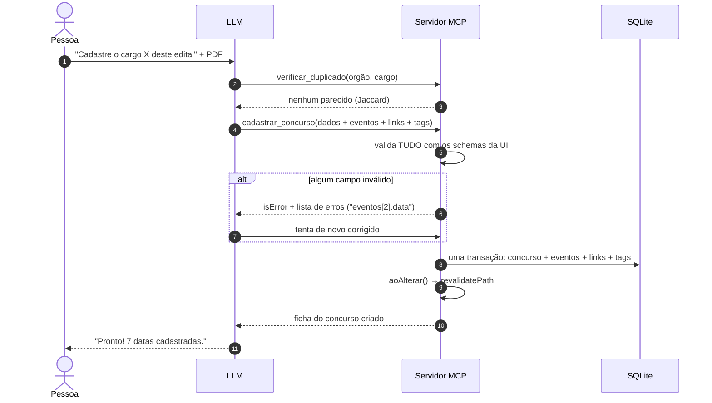

Decisões de design: **nada é excluído pelo MCP** (só pela UI), **um concurso = um cargo**,
**tudo ou nada** (transação única) e o servidor **não baixa PDFs** — quem lê o edital é a LLM.

---

## 11. Inicialização do servidor

O que acontece entre `pnpm start` e a primeira requisição:

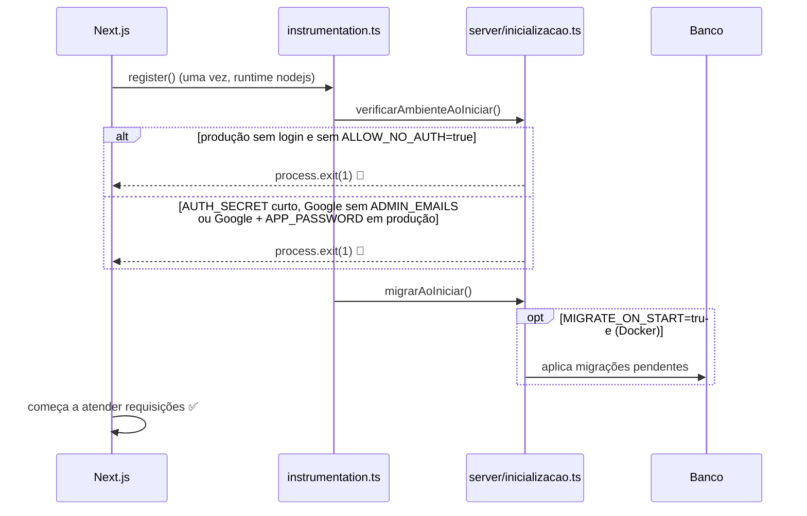

E onde as migrações rodam em cada cenário:

| Comando / ambiente | Quem migra |
|---|---|
| `pnpm dev` | script `predev` → `pnpm db:migrate` |
| `pnpm build` (local, Vercel) | script `prebuild` → `pnpm db:migrate` |
| Docker | `MIGRATE_ON_START=true` → `instrumentation.ts` |
| Testes | banco `:memory:` migrado em cada suíte |

O cliente do banco (`server/db/client.ts`) é um **singleton** guardado em `globalThis`, para não abrir
uma conexão nova a cada recarga do modo dev (HMR).

---

## 12. Onde o app roda

O **mesmo código** atende três cenários; só muda a `DATABASE_URL`. Publicado em HTTPS, o app pode
ser **instalado no celular** como PWA (manifest + ícones; sem service worker).

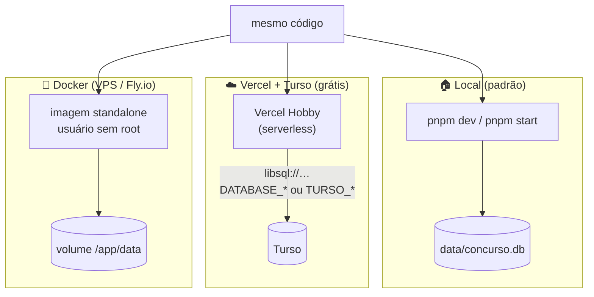

| | Local | Vercel + Turso | Docker |
|---|---|---|---|
| Custo | R$ 0 | R$ 0 | ~US$ 2–5/mês |
| Login | opcional | **obrigatório** (Google) | **obrigatório** (senha ou Google) |
| Backup | `pnpm db:backup` (`VACUUM INTO`) + JSON | restore do Turso + JSON | cópia do volume + JSON |

Backup e restauração universais, que funcionam em qualquer cenário:

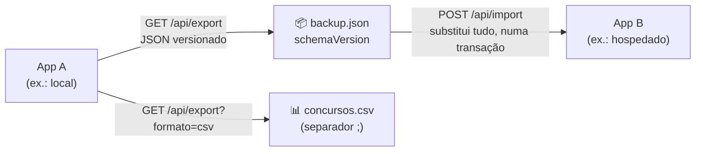

---

## 13. Testes e entrega

### 13.1 A pirâmide de testes

```mermaid
flowchart TB
  E2E["🎭 E2E — Playwright<br/>login, admin, fluxo principal, calendário, quadro,<br/>lembretes, MCP, PWA, celular 360 px…<br/><i>poucos, lentos, realistas</i>"]
  INT["🔗 Integração — Vitest + libSQL :memory:<br/>repositories, queries, export→import,<br/>isolamento entre usuários, servidor MCP<br/><i>banco real em memória</i>"]
  UNI["🧪 Unitários — Vitest<br/>domain/*, lib/*, schemas Zod<br/><i>muitos, rápidos, cobertura ≥ 90% no domínio</i>"]
  E2E --- INT --- UNI

  style UNI fill:#e8f5e9,stroke:#2e7d32
  style INT fill:#fff8e1,stroke:#f9a825
  style E2E fill:#fce4ec,stroke:#ad1457
```

Os testes ficam **ao lado** do código (`status.ts` + `status.test.ts`), rodam com `TZ=UTC` para
provar que nada depende do fuso da máquina e fixam o "hoje" para serem determinísticos.

### 13.2 Fluxo de branches e CI

```mermaid
%%{init: { "gitGraph": { "mainBranchName": "master" } } }%%
gitGraph
  commit id: "v1.2.0" tag: "v1.2.0"
  branch develop
  checkout develop
  commit id: "…"
  branch feature/cor-concurso
  checkout feature/cor-concurso
  commit id: "feat: cor e ícone"
  checkout develop
  merge feature/cor-concurso id: "PR #55"
  branch release/1.3.0
  checkout release/1.3.0
  commit id: "chore(release): 1.3.0"
  checkout master
  merge release/1.3.0 id: "PR #56" tag: "v1.3.0"
  checkout develop
  merge master id: "volta p/ develop"
```

```mermaid
flowchart LR
  PR["PR / push<br/>develop ou master"] --> CHK["check<br/>biome ci → tsc → vitest --coverage → next build"]
  CHK --> E2E["e2e<br/>Playwright"]
  CHK --> DKR["docker<br/>build da imagem + smoke test"]
  PR --> POL["branch-policy<br/>PR p/ master só de release/* ou hotfix/*"]
  TAG["tag vX.Y.Z"] --> REL["release.yml<br/>GitHub Release com notas do CHANGELOG"]
```

---

## 14. Mapa de pastas e "onde mexo para…"

```mermaid
mindmap
  root((concurso))
    src/app
      grupo app: páginas com navegação
      admin/ painel admin
      login/ · manifest.ts
      api/ export · import · health · mcp
      api/ auth/google · calendario.ics
    src/components
      ui/ shadcn
      concurso/ formulários, badges, quadro
      calendario/ · dashboard/ · tema/
      admin/ · auth/ · configuracoes/
      layout/ · notificacoes/
    src/domain
      status · prazos · validade
      notificacoes · icalendar · sugestao-status
      cores · duplicados · quadro · calendario
      enums · labels · erros
    src/lib
      schemas/ Zod
      tz · format · normalize · csv
      tema · pwa · tags
    src/server
      actions/ Server Actions
      queries/ leituras
      repositories/ escritas
      db/ schema · client · migrate
      auth/ sessão · senha · Google · admin · limitador
      mcp/ servidor · operações · textos
    src/proxy.ts
    drizzle/ migrações SQL
    scripts/ migrate · seed · backup · mcp · gerar-icones
    e2e/ Playwright
```

| Quero… | Comece por |
|---|---|
| Adicionar um campo ao concurso | `server/db/schema.ts` → `pnpm db:generate` → `lib/schemas/concurso.ts` → `formulario-concurso.tsx` → `lib/schemas/backup.ts` → `mcp/entradas.ts` |
| Mudar uma regra de status | `domain/status.ts` + `domain/status.test.ts` |
| Mudar o que aparece nos prazos | `domain/prazos.ts` (regra) ou `server/queries/dashboard.ts` (dados) |
| Criar uma nova tela | `src/app/(app)/<rota>/page.tsx` + uma função em `server/queries/` |
| Criar uma nova ação de gravação | `server/repositories/` (transação) + `server/actions/` (receita da §6) |
| Expor algo para a LLM | `server/mcp/operacoes.ts` + registrar em `server/mcp/servidor.ts` |
| Mudar cores/tema | tokens em `src/app/globals.css` (`:root` e `.dark`) |
| Mudar as regras padrão dos lembretes | `domain/notificacoes.ts` (`REGRAS_PADRAO`) + teste |
| Proteger uma nova tela de admin | `src/app/admin/<rota>/page.tsx` com `exigirAdminPagina()` |
| Trocar o logo/ícones | `assets/logo.svg` → `pnpm icones` |

---

## 15. Glossário

| Termo | Significado aqui |
|---|---|
| **Server Component (RSC)** | Componente React que roda só no servidor; pode ser `async` e ler o banco direto. |
| **Client Component** | Arquivo com `"use client"`; roda no navegador (estado, eventos, diálogos). |
| **Server Action** | Função com `"use server"` chamada pelo cliente como se fosse local; o Next faz o POST por baixo. |
| **Route Handler** | `route.ts` em `app/api/…`; endpoint HTTP clássico (export, import, MCP). |
| **`proxy.ts`** | O antigo `middleware.ts` (renomeado no Next 16); roda antes de toda rota. |
| **`revalidatePath`** | Avisa o Next que uma página mudou, para ela ser renderizada de novo com dados novos. |
| **Drizzle** | ORM leve: o schema em TypeScript gera os tipos e as migrações SQL. |
| **libSQL / Turso** | Fork do SQLite com driver que fala com arquivo local **ou** com um banco remoto. |
| **Zod** | Biblioteca de schemas: valida dados e infere o tipo TypeScript. |
| **MCP** | Model Context Protocol: padrão para uma LLM chamar ferramentas de um app. |
| **`ErroDominio`** | Exceção de regra de negócio; vira mensagem amigável ao usuário (ou à LLM). |
| **Pseudo-evento de validade** | Prazo calculado (não gravado) a partir da homologação + meses de validade. |
| **Usuário inicial** | Usuário de ID 1, dono dos dados no uso local (sem login ou com senha única); assumido pelo primeiro admin que entra com Google. |
| **Feed .ics** | Calendário no formato iCalendar que apps como o Google Calendar assinam por URL e sincronizam sozinhos. |
| **PWA** | *Progressive Web App*: o site pode ser instalado no celular e abre em tela cheia, como um app. |
